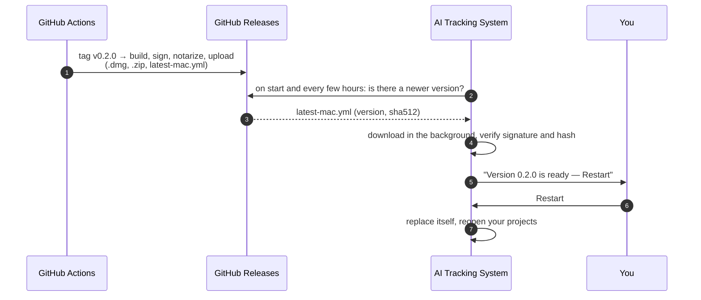
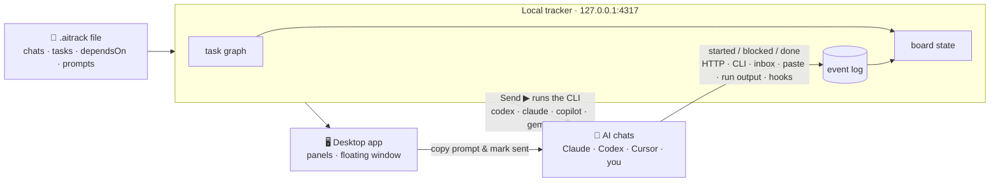
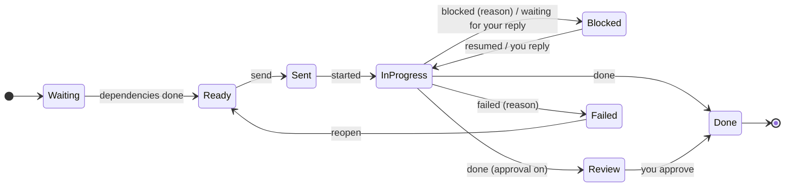

<div align="center">


# AI Tracking System

**Mission control for running many AI coding chats in parallel.**
Plan once, send the green tasks, watch the board move.


**English** · [Türkçe](README.tr.md)

<picture>
  <source media="(prefers-color-scheme: light)" srcset="docs/images/hero-light.png">
  
</picture>

</div>

> [!TIP]
> **The whole idea in one line:** a task turns **green** when everything it depends on is done and its chat is free. Send it — paste the prompt into that chat, or let a Codex / Claude Code / Copilot / Gemini chat **run it by itself**. The chat reports back, the board moves, the next tasks turn green.

<details>
<summary><b>Contents</b></summary>

- [See it move](#-see-it-move)
- [Chats that run themselves](#-chats-that-run-themselves)
- [Install](#-install)
- [Update](#-update)
- [Automatic updates: how we add them](#-automatic-updates-how-we-add-them)
- [How it works](#-how-it-works)
- [Reporting from a chat](#-reporting-from-a-chat)
- [The `.aitrack` file](#-the-aitrack-file)
- [Make it yours](#-make-it-yours)
- [Commands](#-commands)
- [Security](#-security)
- [FAQ](#-faq)

</details>

## 🎬 See it move

### The board updates itself

Two chats get their first tasks, they report back, and the next tasks light up — without touching anything.


<details>
<summary>What happens in this clip</summary>

1. **T-01** and **T-02** are green: they depend on nothing and their chats are free.
2. Clicking a green task opens the drawer: **which chat** gets it, and the **full prompt** — shared context, task, allowed paths, acceptance criteria and how to report.
3. **Copy prompt and mark as sent** puts the prompt on the clipboard; the task moves to *Sent*.
4. The chats report `started`, then `done`. **T-03**, **T-04** and **T-05** unlock and turn green.
5. A chat reports `blocked` with a reason — the card shows it in red, and you get a notification.

</details>

### Chats that run themselves

Auto-dispatch is switched on: free chats get their ready tasks, their output streams in, Claude asks a question and gets a reply from the drawer, and finished work unlocks the next tasks — which start on their own.


### Floating window

<table>
<tr>
<td width="300"></td>
<td>

A small glass window that **stays on top of every app** — your editor, the Codex app, Claude — and on every desktop.

- what each chat is doing right now
- what **waits for you**: tasks to send, approvals, blocks
- **one click** copies the next prompt and marks it sent
- click a chat or task to jump to it in the main window
- views: **overview**, **compact list**, **mini lanes**; choose sections and chats, pin it, change its opacity

Open it from the sidebar, or <kbd>⇧</kbd><kbd>⌘</kbd><kbd>F</kbd>.

</td>
</tr>
</table>

### Make it yours

Screens are built from **panels**. Add, drag, resize, filter them by chat, keep several layouts, and pick your theme and accent.


## 🤖 Chats that run themselves

Set a chat up once (the **⚙ by hand** badge on its lane) and **Send** gives it the task directly — no copy and paste.

| | |
| --- | --- |
| **Runs with** | Codex CLI · Claude Code · GitHub Copilot CLI · Gemini CLI · any command (Cursor CLI, Aider, scripts) |
| **Where** | the project's repository, or a folder per chat (a git worktree when several chats edit code) |
| **Access** | read only · edit files (default) · full access |
| **Conversation** | continues the same session, like a chat you keep open — or a new session per task. Paste an existing session id to continue *that* chat. |
| **Status** | *started* on the first output, *done* from the report at the end, **waiting for your reply** when the agent asks — answer with **Reply** |
| **Live** | commands, edits and messages stream into the task drawer; **Stop** at any time |
| **Auto-dispatch** | the switch in the header: free chats get their most urgent ready task, up to *N* at once |
| **Your own sessions** | a one-line hook for Claude Code and Codex marks tasks *in progress* and *waiting for your reply* as you work |

> [!IMPORTANT]
> The CLIs run on your computer with **your own sign-in and plan**. Run settings stay in `~/.aitrack/runners.json`, never in the project file, and starting an agent needs the app's control token — a shared `.aitrack` file or a web page cannot start anything. Keep tasks that need a person (payments, identity checks, legal acceptance) with a chat you run by hand.

Everything — commands per CLI, access levels, sessions, hooks, API: **[docs/agent-runners.md](docs/agent-runners.md)**.

## 📦 Install

> [!NOTE]
> You need **Node.js 22.12+** to build the app. The installed app does not need it.

<details open>
<summary><b>macOS — double-click install</b></summary>

1. Clone the repository (Terminal or GitHub Desktop):
   ```bash
   git clone https://github.com/mitradeniz/ai-tracking-system.git
   ```
2. In Finder, open the folder and double-click **`install-macos.command`**.
3. A Terminal window builds the app, puts **AI Tracking System** in Applications and Launchpad, and opens it.

From then on, double-clicking any `.aitrack` file opens it in the app.

> [!IMPORTANT]
> If macOS says the installer cannot be opened, **right-click → Open** once. The app is signed ad hoc on your own machine, not with a Developer ID, so it is meant for your computer, not for sharing as a download.

</details>

<details>
<summary><b>Windows and Linux</b></summary>

```bash
npm install
npm run dist        # installers in apps/desktop/release/ (.exe, .AppImage)
```

The builds are not code-signed; on Windows choose *More info → Run anyway*.

</details>

<details>
<summary><b>Run from source, or in a browser tab</b></summary>

```bash
npm install
npm run desktop                                   # build and start the desktop app
npm run serve -- examples/landing-page.aitrack    # same UI at http://127.0.0.1:4317
```

</details>

**First steps:** open the app → **Add project → Browse…** → pick `examples/landing-page.aitrack` (or a `.aitrack` file from your own repository).

## 🔄 Update

| | How |
| --- | --- |
| **macOS** | Double-click **`update-macos.command`**. It pulls the latest version from GitHub and, if there is one, reinstalls the app. Your projects and task status are kept. |
| **Terminal** | `git pull` then double-click `install-macos.command` again (or `npm run update:mac`). |
| **Windows / Linux** | `git pull && npm install && npm run dist`, then install the new build. |

<details>
<summary>What the updater checks before it changes anything</summary>

- The folder must be a clean git clone. If `package-lock.json` is the only changed file (npm rewrites it on some machines), it is restored, because the installer always uses the committed lockfile.
- Any other local change stops the update and tells you to commit or stash it.
- The current branch must follow a branch on GitHub (usually `main`), and the update must be a fast-forward — nothing is merged or overwritten.
- If you are already up to date, nothing is rebuilt.

</details>

## 🚀 Automatic updates: how we add them

Today updates are one double-click. True in-app updates ("A new version is ready — restart") are on the roadmap. This is the plan:



- [ ] **Release pipeline** — a GitHub Actions workflow that runs `electron-builder --publish always` on version tags and uploads installers plus the `latest*.yml` update manifests to GitHub Releases.
- [ ] **Code signing** — Apple Developer ID + notarization on macOS (the macOS updater only installs signed builds), Authenticode on Windows. Secrets live in GitHub encrypted secrets, never in the repository.
- [ ] **`electron-updater`** in the desktop shell — check on start and every few hours, download in the background, verify, and offer *Restart to update*; never interrupt a running task.
- [ ] **Update banner in the UI** — version, release notes, *Restart* / *Later*; a setting to turn checks off.
- [ ] **Channels** — `stable` and `beta`, chosen in settings.
- [ ] **Until signing is in place** — a lightweight check of the GitHub Releases API that only *tells* you a new version exists and points to `update-macos.command`.

## 🧭 How it works



1. **Plan.** A `.aitrack` file lists the chats, the tasks with their real dependencies, and the prompts. Write it by hand or let an AI write it from your plan — see [Authoring a project with AI](docs/authoring-with-ai.md).
2. **Open.** The app validates it (unknown ids, cycles, missing prompts) and lays it out as a graph.
3. **Start sessions.** In each chat's lane, copy the **Session prompt** once.
4. **Dispatch.** Send the green tasks — by hand, with **Send ▶** for chats that run themselves, or let **auto-dispatch** do it.
5. **Track.** Chats report as they work; dependents unlock; blocked tasks say why.
6. **Share.** **Export** writes the plan, optionally with a status snapshot, back to a file you can commit.

<details>
<summary><b>Task lifecycle</b></summary>



| State | Meaning |
| --- | --- |
| Waiting | Some dependencies are not done yet. |
| Ready / **Send now** | Dependencies done and an eligible chat has room. Green. |
| Ready, chat busy | Dependencies done, but every eligible chat is at its `maxParallel` limit. |
| Sent | You gave the task to a chat (copied, or started its run); it has not started yet. |
| In progress | The chat reported `started` or `progress`. |
| Blocked | The chat reported `blocked` with a reason, or stopped to ask you something (*waiting for your reply*). Still holds the chat. |
| In review | Waiting for your approval (`requireApproval`, or the chat reported `review`). |
| Done | Reported `done` (and approved, if approval is required). Unblocks dependents. |
| Failed | The chat gave up, with a reason. Reopen it to send it again. |

Every state can also be set by hand from the task drawer.

</details>

## 📡 Reporting from a chat

Every prompt ends with a short **REPORTING** section, so chats know how to report without extra setup. Four channels, in order of preference:

| Channel | When to use it |
| --- | --- |
| **HTTP** `POST /api/report` | The chat runs on your machine. |
| **CLI** `aitrack-report --task T-03 --status done` | Same, with automatic fallback to the inbox. |
| **Inbox file** `.aitrack/inbox/<task>-<status>-<ms>.json` | The chat runs in a sandbox that cannot reach localhost. Git worktrees are scanned too. |
| **Paste** an ` ```aitrack-report ` block | Cloud chats that cannot reach your disk. |
| **Run output** | Chats that [run themselves](docs/agent-runners.md): the block at the end of the final message is read automatically. |
| **Hooks** | Claude Code and Codex sessions you open yourself: turn start and end. |

Details and the report schema: [docs/agent-reporting.md](docs/agent-reporting.md).

## 📄 The `.aitrack` file

<details>
<summary>A small example</summary>

```json
{
  "$schema": "https://raw.githubusercontent.com/mitradeniz/ai-tracking-system/main/schema/aitrack.schema.json",
  "format": "aitrack",
  "version": 1,
  "project": { "id": "landing-page", "name": "Landing page" },
  "agents": [
    { "id": "claude-a", "name": "Claude A", "tool": "claude", "bootstrapPrompts": ["context"] },
    { "id": "codex-a", "name": "Codex A", "tool": "codex", "bootstrapPrompts": ["context"] }
  ],
  "tasks": [
    { "id": "T-01", "title": "API contract", "agent": "claude-a", "prompts": ["contract"] },
    { "id": "T-02", "title": "Page against the mock", "agent": "codex-a", "dependsOn": ["T-01"],
      "instructions": "Build the page using the mock server.", "allowedPaths": ["src/"] }
  ],
  "prompts": {
    "context": { "title": "Shared context", "body": "You are working on …" },
    "contract": { "title": "Contract", "body": "Write contracts/openapi.yaml …" }
  }
}
```

</details>

Full reference: [docs/file-format.md](docs/file-format.md) · JSON Schema: [`schema/aitrack.schema.json`](schema/aitrack.schema.json) · validate with `npm run validate -- path/to/project.aitrack`.

**New project?** Give your plan to an AI together with [these instructions](docs/authoring-with-ai.md), save the answer as `<project>.aitrack` in that repository, validate it and **Add project**.

## 🎨 Make it yours

| | |
| --- | --- |
| **Panels** | Ready to send · Chat lanes · Flow · List · Needs you · Recent activity · Progress. Add, drag, resize (¼ to full width, auto to full height) and limit each to some chats. |
| **Layouts** | As many as you like — *Morning*, *Only Claude*, *Review time*. Built-in: Chats, Overview, Flow, List. |
| **Chats** | **+ Add chat** at the end of the lanes, ✏️ on a lane to edit or remove one. A new chat can take over tasks of busy chats. |
| **Appearance** | Theme (dark, light, system), accent colour, density, text size, glass strength, language (English, Türkçe). |
| **Glass** | On macOS the window is translucent and takes the tone of whatever is behind it; the floating window too. |

## 🧰 Commands

| Command | What it does |
| --- | --- |
| `npm run desktop` | Build everything and start the desktop app. |
| `npm run serve -- [files…]` | Tracker and web UI on `127.0.0.1:4317` (`--port`, `--data-dir`). Prints a link with the control token for running chats from a browser. |
| `npm run dev:web` | Development: tracker with reload plus the Vite dev server. |
| `npm run dist` | Build installers with electron-builder. |
| `npm run install:mac` / `npm run update:mac` | Same as double-clicking the installer / updater. |
| `npm test` · `npm run typecheck` | Tests (Vitest) and TypeScript checks. |
| `npm run validate -- <files…>` | Validate `.aitrack` files. |
| `npm run schema` | Regenerate the JSON Schema from the zod schema. |

Environment: `AITRACK_PORT` (default `4317`), `AITRACK_DATA_DIR` (default `~/.aitrack`), `AITRACK_SERVER` (reporter CLI).

<details>
<summary>Repository layout</summary>

```text
packages/core       file format (zod), task graph, board logic, prompt rendering, file edits — no I/O
packages/server     local tracker: registry, event log, inbox watcher, agent runners and hooks, HTTP API, SSE
packages/ui         React UI: panels, layouts, floating window, appearance; English and Turkish
packages/reporter   aitrack-report CLI for agents, zero dependencies
apps/desktop        Electron shell: tracker, translucent windows, floating window, .aitrack association
schema/             generated JSON Schema
examples/           example projects
docs/               file format, reporting, authoring with AI, images
```

</details>

## 🔒 Security

- The tracker listens on **127.0.0.1 only**, refuses foreign `Host` headers (DNS rebinding) and cross-origin writes, and requires `application/json` for writes.
- Windows run with context isolation and the sandbox; the native bridge is limited to file dialogs, the floating window and the control token, and every call is checked in the main process.
- Starting agents needs a **control token** (`~/.aitrack/control-token`); run settings live only on your computer, never in project files.
- Reports are data: they change task status and are shown as text, never executed.
- Do not put secrets in `.aitrack` files or reports — the file is meant to be committed.

More in [SECURITY.md](SECURITY.md).

## ❓ FAQ

<details>
<summary><b>Does it talk to Claude or Codex for me?</b></summary>

Yes, if you want. A chat set to run by itself is started through its official CLI — Codex CLI, Claude Code, GitHub Copilot CLI, Gemini CLI or your own command — with your sign-in; the session continues across tasks and you can reply from the app. Chats you run by hand keep working with copy and paste, and can report through hooks. See [docs/agent-runners.md](docs/agent-runners.md).

</details>

<details>
<summary><b>Where is my data?</b></summary>

The plan is your `.aitrack` file. Status events are in `~/.aitrack/events/` on your machine, run settings in `~/.aitrack/runners.json` and run output in `~/.aitrack/runs/`. Layouts and appearance are stored in the app. The tracker itself sends nothing anywhere; the prompts you give to AI chats leave your computer with those chats.

</details>

<details>
<summary><b>Can several projects be open at once?</b></summary>

Yes. Each project is a `.aitrack` file in its own repository; the sidebar lists them and the floating window can follow any of them.

</details>

<details>
<summary><b>My chat runs in the cloud and cannot reach localhost.</b></summary>

Use the inbox file (if the chat works in a worktree on your disk) or paste the `aitrack-report` block that every prompt asks the chat to end with.

</details>

---

<div align="center">

Version 0.1 · the file format is versioned and stays backward compatible within a major version · [Contributing](CONTRIBUTING.md) · [Changelog](CHANGELOG.md)

</div>
