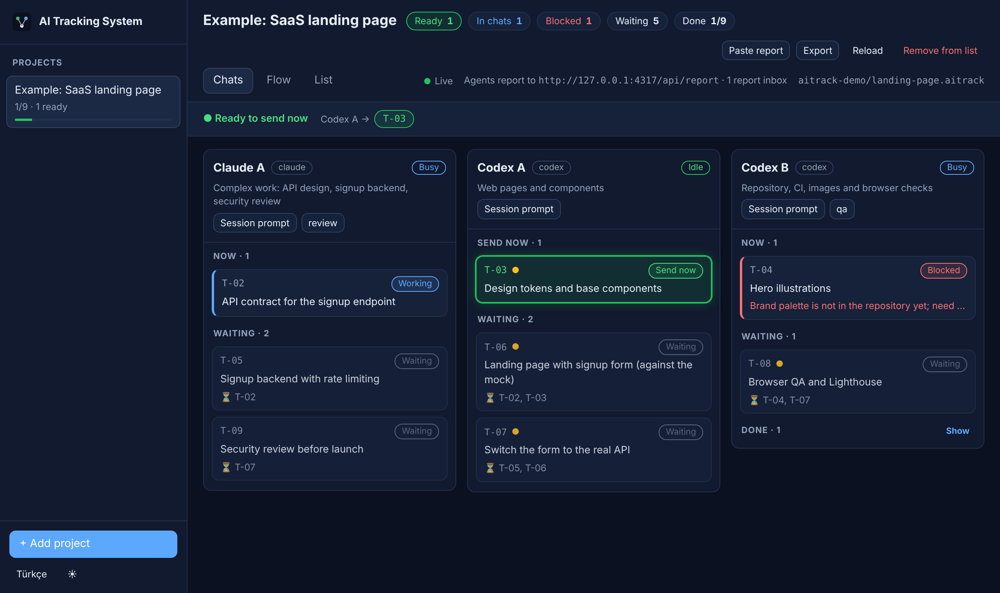
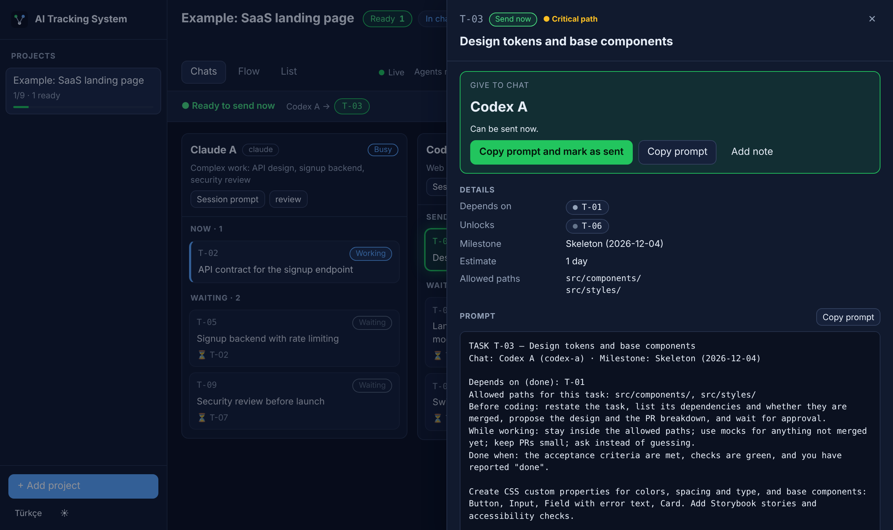

# AI Tracking System

Desktop mission control for running several AI coding chats in parallel on one project.

You describe the work once as a task graph in a `.aitrack` file: which chat does what, what each task depends on, and the prompt to send. The app shows which tasks can be sent **right now** (they glow green), which chat to give each one to, and the exact prompt to copy. The chats report back when they start, finish or get stuck, and the board updates live — so you always see what is done, what is running, and why the rest is not moving.

It is tool-agnostic: the "chats" can be Claude, Codex, Cursor, a human, or anything that can run one shell command or write one JSON file.



## Why

When three to five AI chats work on the same codebase, the slow part is no longer writing code. It is you: remembering which task unblocks which, which chat is free, which prompt goes where, and noticing that a chat has been stuck for an hour. AI Tracking System turns that into a board:

- **Parallel by default.** Tasks only wait for their real dependencies. Everything whose dependencies are done and whose chat has room is shown as sendable.
- **One click to dispatch.** Click a task: you see the chat it goes to and the full prompt (shared context, task instructions, allowed paths, acceptance criteria and reporting instructions). Copy, paste, done.
- **Reports, not guesswork.** Each prompt tells the chat how to report `started`, `blocked`, `review`, `done` or `failed`. A blocked task shows the reason on the board.
- **Why not now?** Every task that cannot be sent explains itself: waiting for `T-05`, chat busy with `T-02`, blocked by the agent, awaiting your approval, failed.
- **Critical path.** The longest chain is marked, so you know which work to unblock first.
- **Local and private.** Everything runs on `127.0.0.1`. No account, no telemetry, no cloud.
- **Plain files.** The plan is a JSON file you keep in your repository and review in pull requests. Status lives in a local event log and can be exported back into the file as a snapshot.

## Quick start

Requirements: Node.js 22.12 or newer.

```bash
git clone https://github.com/mitradeniz/ai-tracking-system.git
cd ai-tracking-system
npm install
npm run desktop          # builds and opens the desktop app
```

Then **Add project → Open** and pick `examples/landing-page.aitrack`, or a `.aitrack` file from your own repository.

Prefer a browser tab? `npm run serve -- examples/landing-page.aitrack` starts the same tracker and UI at <http://127.0.0.1:4317>.

To build installers (`.dmg`, `.exe`, `.AppImage`) for your platform:

```bash
npm run dist             # output in apps/desktop/release/
```

The builds are not code-signed. On macOS, open the app with right-click → Open the first time; on Windows, choose "More info → Run anyway".

## How it works

```text
 .aitrack file (in your repo)          AI chats (Claude, Codex, …)
 agents · tasks · dependsOn · prompts       │  report started / blocked / done
            │                               │  HTTP · CLI · inbox file · paste
            ▼                               ▼
   ┌──────────────── local tracker on 127.0.0.1:4317 ────────────────┐
   │ project registry · event log (JSONL) · DAG · report API · SSE   │
   └──────────────────────────────┬──────────────────────────────────┘
                                  ▼
                 Desktop app: lanes · flow · list · task drawer
```

1. **Plan.** A `.aitrack` file lists the chats (`agents`), the `tasks` with `dependsOn`, and reusable `prompts`. You can write it by hand or have an AI write it from your plan — see [Authoring a project with AI](docs/authoring-with-ai.md).
2. **Open.** Add the file to the app. It is validated (unknown ids, cycles, missing prompts) and laid out as a graph.
3. **Start sessions.** In each chat's lane, copy the **session prompt** once to give that chat its role and shared context.
4. **Dispatch.** Green tasks are ready. Click one, check the chat, press **Copy prompt and mark as sent**, paste it into that chat.
   

5. **Track.** The chat reports as it works. The board moves; newly unblocked tasks turn green; when the window is in the background you get a desktop notification.
6. **Share.** **Export** writes the plan (optionally with a status snapshot) back to a `.aitrack` file you can commit.

### Task states

| State | Meaning |
| --- | --- |
| Waiting | Some dependencies are not done yet. |
| Ready / **Send now** | Dependencies done and an eligible chat has room. Shown in green. |
| Ready, chat busy | Dependencies done, but every eligible chat is at its `maxParallel` limit. |
| Sent | You copied the prompt to a chat; it has not reported yet. |
| In progress | The chat reported `started` or `progress`. |
| Blocked | The chat reported `blocked`, with a reason. Still holds the chat. |
| In review | Waiting for your approval (when `requireApproval` is on, or the chat reported `review`). |
| Done | Reported `done` (and approved, if approval is required). Unblocks dependents. |
| Failed | The chat gave up, with a reason. Reopen it to send it again. |

You can also change any state by hand from the task drawer.

## Reporting from a chat

Every rendered prompt ends with a reporting section that tells the chat exactly how to report. Four channels are accepted, in this order of preference:

1. **HTTP** — `curl -s -X POST http://127.0.0.1:4317/api/report -H 'content-type: application/json' -d '{"task":"T-03","status":"done","summary":"…"}'`
2. **CLI** — `node <path-to-this-repo>/packages/reporter/bin/aitrack-report.mjs --task T-03 --status done --summary "…"` (zero dependencies; falls back to the inbox automatically)
3. **Inbox file** — write the same JSON to `.aitrack/inbox/<task>-<status>-<unix-ms>.json` in the repository (any git worktree of `settings.repoPath` is scanned too). Useful when the chat runs in a sandbox that cannot reach localhost.
4. **Paste** — the chat ends its reply with an ` ```aitrack-report ` block; paste it into **Paste report**.

Details and the full report schema: [docs/agent-reporting.md](docs/agent-reporting.md).

## The `.aitrack` file

A small example:

```json
{
  "$schema": "https://raw.githubusercontent.com/mitradeniz/ai-tracking-system/main/schema/aitrack.schema.json",
  "format": "aitrack",
  "version": 1,
  "project": { "id": "landing-page", "name": "Landing page" },
  "agents": [
    { "id": "claude-a", "name": "Claude A", "tool": "claude", "bootstrapPrompts": ["context"] },
    { "id": "codex-a", "name": "Codex A", "tool": "codex", "bootstrapPrompts": ["context"] }
  ],
  "tasks": [
    { "id": "T-01", "title": "API contract", "agent": "claude-a", "prompts": ["contract"] },
    { "id": "T-02", "title": "Page against the mock", "agent": "codex-a", "dependsOn": ["T-01"],
      "instructions": "Build the page using the mock server.", "allowedPaths": ["src/"] }
  ],
  "prompts": {
    "context": { "title": "Shared context", "body": "You are working on …" },
    "contract": { "title": "Contract", "body": "Write contracts/openapi.yaml …" }
  }
}
```

Full reference: [docs/file-format.md](docs/file-format.md). JSON Schema: [`schema/aitrack.schema.json`](schema/aitrack.schema.json). Validate files from the command line with `npm run validate -- path/to/project.aitrack`.

## Using it across projects

The app keeps a list of open projects; each points to a `.aitrack` file that lives in that project's repository. Add as many as you like. To bring a new project in:

1. Give your planning document to an AI together with the instructions in [docs/authoring-with-ai.md](docs/authoring-with-ai.md).
2. Save its output as `<project>.aitrack` in the repository and run `npm run validate -- <file>`.
3. **Add project** in the app.

## Commands

| Command | What it does |
| --- | --- |
| `npm run desktop` | Build everything and start the desktop app. |
| `npm run serve -- [files…]` | Start the tracker and web UI on `127.0.0.1:4317` (`--port`, `--data-dir`). |
| `npm run dev:web` | Development: tracker with reload plus the Vite dev server. |
| `npm run dist` | Build installers with electron-builder. |
| `npm test` | Unit and API tests (Vitest). |
| `npm run typecheck` | TypeScript checks for all packages. |
| `npm run validate -- <files…>` | Validate `.aitrack` files. |
| `npm run schema` | Regenerate `schema/aitrack.schema.json` from the zod schema. |

Environment variables: `AITRACK_PORT` (desktop app, default `4317`), `AITRACK_DATA_DIR` (default `~/.aitrack`), `AITRACK_SERVER` (reporter CLI).

## Repository layout

```text
packages/core       file format (zod), DAG, board logic, prompt rendering — no I/O
packages/server     local tracker: registry, event log, inbox watcher, HTTP API, SSE
packages/ui         React UI (lanes, flow, list, task drawer), English and Turkish
packages/reporter   aitrack-report CLI for agents, zero dependencies
apps/desktop        Electron shell: starts the tracker, file dialogs, .aitrack association
schema/             generated JSON Schema
examples/           example projects
docs/               file format, reporting, authoring with AI
```

## Security

The tracker listens on `127.0.0.1` only, refuses requests whose `Host` is not a loopback name (DNS rebinding), refuses cross-origin browser writes, and requires `application/json` for writes. The desktop window runs with context isolation and sandboxing; the only native bridge is file dialogs. Reports are data: they change task status and are shown as text, never executed. See [SECURITY.md](SECURITY.md).

Do not put secrets in `.aitrack` files or in reports — the file is meant to be committed.

## Status

Version 0.1. The file format is versioned (`"version": 1`) and will stay backward compatible within a major version.

Contributions are welcome — see [CONTRIBUTING.md](CONTRIBUTING.md).
