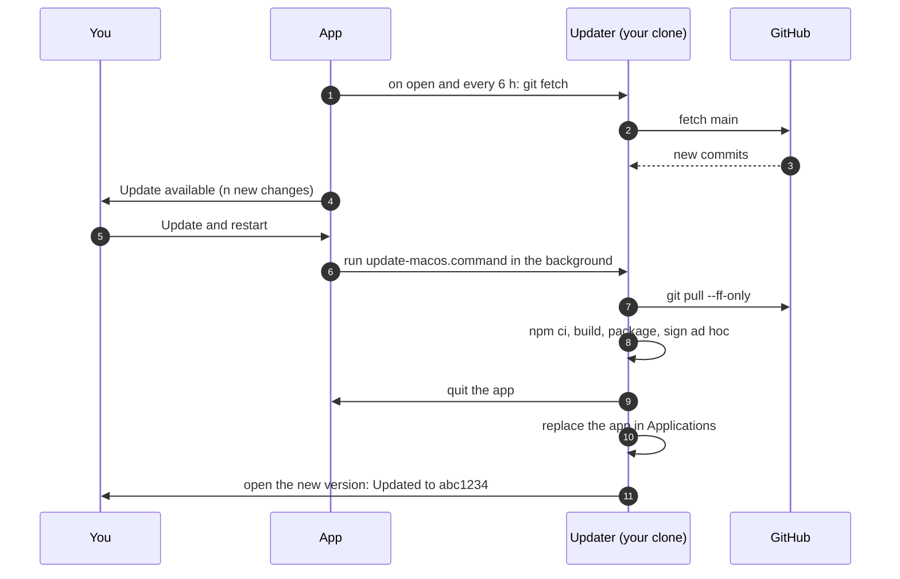
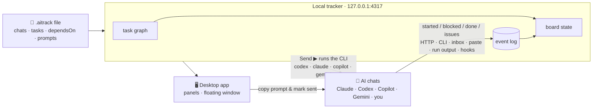
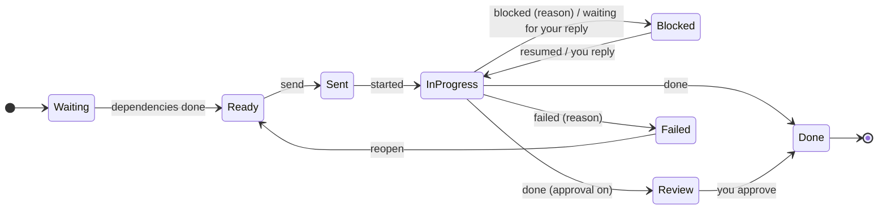

<div align="center">


# AI Tracking System

**Mission control for running many AI coding chats in parallel.**
Plan once, send the green tasks — or let the chats run themselves — and watch the board move.


**English** · [Türkçe](README.tr.md)

<picture>
  <source media="(prefers-color-scheme: light)" srcset="docs/images/hero-light.png">
  
</picture>

</div>

> [!TIP]
> **The whole idea in one line:** a task turns **green** when everything it depends on is done and its chat is free. Send it — paste the prompt into that chat, or let a Codex / Claude Code / Copilot / Gemini chat **run it by itself**. The chat reports back, the board moves, the next tasks turn green. If something went wrong, the task gets a red **!** with a fix prompt ready to send.

<details>
<summary><b>Contents</b></summary>

- [What's inside](#-whats-inside)
- [See it move](#-see-it-move)
- [Install](#-install)
- [Updates](#-updates)
- [Start a project](#-start-a-project)
- [Edit the plan in the app](#%EF%B8%8F-edit-the-plan-in-the-app)
- [Quick start](#-quick-start)
- [Chats that run themselves](#-chats-that-run-themselves)
- [Problems, run details and your own prompts](#-problems-run-details-and-your-own-prompts)
- [How it works](#-how-it-works)
- [Reporting from a chat](#-reporting-from-a-chat)
- [The `.aitrack` file](#-the-aitrack-file)
- [Make it yours](#-make-it-yours)
- [Keyboard shortcuts](#%EF%B8%8F-keyboard-shortcuts)
- [Commands](#-commands)
- [Where your data lives](#-where-your-data-lives)
- [Security](#-security)
- [FAQ](#-faq)
- [Roadmap](#%EF%B8%8F-roadmap)

</details>

## ✨ What's inside

| | |
| --- | --- |
| 🆕 **New project wizard** | Pick the folder, the chats (suggested from the AI CLIs on your computer) and how to plan: Claude Code or Codex writes the tasks from your plan, any other AI does it by copy and paste, or you start empty. No JSON to write. |
| ✏️ **Plan editor** | Add, change and remove tasks and prompts in the app: which chat takes a task, what it waits for, its instructions, allowed paths and acceptance criteria. |
| 🟢 **A board that knows what's next** | Tasks unlock when their dependencies are done and their chat has room. *Ready to send* shows the green ones at a glance; every other task says why it is waiting. |
| 🤖 **Chats that run themselves** | Codex CLI, Claude Code, GitHub Copilot CLI, Gemini CLI or any command run the task in their own session, in your repository. Output streams in live; you reply, approve and stop from the app or the floating window. |
| ⚡ **Auto-dispatch** | One switch: free chats pick up their most urgent ready task, up to *N* at once, as soon as it turns green. |
| 🌙 **Manager** | Going to bed? Hand the project to an AI CLI you choose: it answers waiting chats, picks options, parks tasks that wait for others, sends failed ones again and adds work left for later to the plan. Payments, accounts, legal terms, publishing and risky steps stay with you; what it did and what it left for you is listed. |
| 📋 **Proposed tasks** | Work a chat left for later — a placeholder to replace, a check to add — becomes a proposed task instead of a question for you: add it to the plan, ignore it, or let a CLI fold them all into the current plan, previewed before anything is written. |
| ❗ **Problems in plain words** | What a chat could not do, skipped or needs from you is marked with a red **!** everywhere, explained in your language, with a fix prompt ready to edit, copy or send. A decision comes with the chat's options as buttons; refused steps come on one card that says what each does, with **Allow and continue**. Mark a problem resolved or ignore it. |
| ⏱️ **Run details** | Elapsed time, tool calls, tokens, turns, list price and how full the session's context is — live. |
| ✍️ **Your own prompts** | Add instructions when sending, write to a chat's session at any time, keep a list of saved prompts. |
| 🪟 **Floating window** | A small always-on-top window over your editor and the AI apps: what each chat is doing, what waits for you, one-click send — and replies, approvals, fixes and stop right there. |
| 🧩 **Panels and layouts** | Build screens from panels, drag and resize them, filter by chat, keep as many layouts as you like. |
| 🎨 **Black and white UI** | A high-contrast black theme (and a white one) where only status speaks in colour. Collapsible sidebar, ⓘ tips that explain each switch, and a short intro the first time you open the app. |
| 📌 **Your project list** | Pin projects to the top, drag them into your own order, remove them from the list or move their file to the Trash. |
| 🔄 **One-click updates** | On macOS the app checks GitHub and updates itself: **Update and restart**, or let it install new versions when no chat is running. |
| 🔌 **Works with any chat** | Chats you run by hand report over HTTP, a CLI, an inbox file, a pasted block or a one-line hook. |
| 🏠 **Local first** | Runs on `127.0.0.1`, no account, no telemetry. The plan is a file you commit. |

## 🎬 See it move

### The board updates itself

Two chats get their first tasks by hand, they report back, and the next tasks light up.


<details>
<summary>What happens in this clip</summary>

1. **T-01** and **T-02** are green: they depend on nothing and their chats are free.
2. Clicking a green task opens the drawer: **which chat** gets it and the **full prompt** — shared context, task, allowed paths, acceptance criteria and how to report.
3. **Copy prompt and mark as sent** puts the prompt on the clipboard; the task moves to *Sent*.
4. The chats report `started`, then `done`. **T-03**, **T-04** and **T-05** unlock and turn green.
5. **T-04** is sent and its chat reports `blocked` with a reason — the card turns red and you get a notification.

</details>

### Chats that run themselves

Auto-dispatch is switched on: free chats start their ready tasks, their commands stream in, Claude Code asks a question and gets a reply from the drawer, and finished work unlocks the next tasks — which start on their own.


### Floating window

<table>
<tr>
<td width="300"></td>
<td>

A small window that **stays on top of every app** — your editor, the Codex app, Claude — and on every desktop.

- what each chat is doing right now, with its live command and timer
- what **waits for you**: tasks to send, replies, approvals, blocks and problems (**!**)
- **one click** sends the next task — it starts the chat's run, or copies the prompt for chats you run by hand
- click a chat or task to act on it right there: answer the chat or approve its plan, send a problem's fix, allow a refused command, mark a problem resolved or ignored, stop a run, approve, mark done or reopen — **↗** opens it in the main window
- views: **overview**, **compact list**, **mini lanes**; choose sections and chats, pin it, change its opacity

Open it from the sidebar, the *Window* menu, or <kbd>⇧</kbd><kbd>⌘</kbd><kbd>F</kbd>.

</td>
</tr>
</table>

### Make it yours

Screens are built from **panels**. Add, drag, resize, filter them by chat, keep several layouts, pick the theme and accent, and fold the sidebar away.


## 📦 Install

| You need | Why |
| --- | --- |
| **Node.js 22.12+** | To build the app. The installed app does not need it. |
| **git** | To clone the repository and for one-click updates. On macOS: `xcode-select --install`. |
| An AI CLI *(optional)* | `codex`, `claude`, `copilot` or `gemini`, signed in, for chats that run themselves. Without one, chats work by copy and paste. |

<details open>
<summary><b>macOS — double-click install</b> (recommended)</summary>

1. Clone the repository (Terminal or GitHub Desktop):
   ```bash
   git clone https://github.com/mitradeniz/ai-tracking-system.git
   ```
2. In Finder, open the folder and double-click **`install-macos.command`**.
3. A Terminal window does four steps — **install dependencies** (the first run downloads Electron, about 150 MB) → **build** → **package the app for this Mac** → **install** — and opens the app.

The result:

- **AI Tracking System** is in `/Applications` (or `~/Applications` if that is not writable) and in Launchpad.
- Double-clicking a `.aitrack` file opens it in the app.
- The installer remembers which clone it was built from (`~/.aitrack/install.json`), so the app can [update itself](#-updates) from now on.

> [!IMPORTANT]
> Keep the cloned folder — updates are pulled and built there. If macOS says the installer cannot be opened, **right-click → Open** once. The app is signed ad hoc on your own machine, not with a Developer ID, so it is meant for your computer, not for sharing as a download.

</details>

<details>
<summary><b>macOS — as a disk image (.dmg)</b></summary>

Prefer dragging the app to Applications yourself? Double-click **`make-dmg-macos.command`** instead. It does the same first three steps, then makes `release/AI-Tracking-System-<version>-<commit>-<arch>.dmg` in the clone and opens it: **quit the app if it is running**, then drag **AI Tracking System** onto **Applications**. Updates from the app work the same way afterwards. Like the installer, the image is signed ad hoc on your Mac and is meant for this computer.

</details>

<details>
<summary><b>Windows and Linux</b></summary>

```bash
git clone https://github.com/mitradeniz/ai-tracking-system.git
cd ai-tracking-system
npm install
npm run dist        # installers in apps/desktop/release/ (.exe, .AppImage)
```

The builds are not code-signed; on Windows choose *More info → Run anyway*.

</details>

<details>
<summary><b>Run from source, or in a browser tab</b></summary>

```bash
npm install
npm run desktop                                   # build and start the desktop app
npm run serve -- examples/landing-page.aitrack    # same UI at http://127.0.0.1:4317
```

`serve` prints a link with the control token; open that link to start agents from the browser.

</details>

## 🔄 Updates

<table>
<tr>
<td width="380"></td>
<td>

**On macOS the app updates itself.** When there is a new version on GitHub you see **↑ Update available** at the bottom of the sidebar.

1. Click it — or open **Settings → Updates**, or **AI Tracking System → Check for Updates…** in the menu bar.
2. You see this version and the new changes, one line per commit.
3. Click **Update and restart**.

The app keeps working while the new version is built (a few minutes). Then it closes and opens the new version by itself, with a note *"Updated to …"*. Your projects, layouts, run settings and task status are kept.

**Automatic options** (in the same place):

- **Check when the app opens and every 6 hours** — on by default.
- **Install new versions by itself when no chat is running** — off by default. It waits until no agent is running, so a task is never cut off.

</td>
</tr>
</table>

### How it works

There is no separate download server: the app updates the git clone it was installed from, with the same scripts you can double-click yourself.



1. **Check.** The app runs `git fetch` in its clone and compares your branch with the one it follows on GitHub (usually `origin/main`). Nothing is changed by a check.
2. **Update.** **Update and restart** starts `update-macos.command` in the background with `AITRACK_UNATTENDED=1` (no prompts). It pulls (fast-forward only) and hands over to `install-macos.command`.
3. **Rebuild and swap.** The installer installs the locked dependencies, builds, packages the app for this Mac, quits the running app, replaces it in Applications and opens the new version.
4. **Report back.** Progress goes to `~/.aitrack/update-status.json` and the full output to `~/.aitrack/update.log`; the Updates section shows the last lines live, and the new version tells you it was updated (or why it failed).

> [!NOTE]
> **Chats that are running** stop when the app restarts. If any are running, the app asks first. Interrupted runs are marked *blocked* on the next start; reply to them or send them again to continue the same session.

### Before it changes anything

- The folder must be a git clone whose branch follows a branch on GitHub, and the update must be a **fast-forward** — nothing is merged, rebased or overwritten.
- Local changes stop the update. The one exception is `package-lock.json` alone (npm rewrites it on some machines): it is restored, because the installer always uses the committed lockfile.
- If you are already up to date, nothing is rebuilt.

### Other ways to update

| | How |
| --- | --- |
| **macOS, double-click** | Double-click **`update-macos.command`** in the clone. Same steps as the button, in a Terminal window. |
| **macOS, Terminal** | `npm run update:mac` — or `git pull`, then `npm run install:mac`. |
| **Windows / Linux** | `git pull && npm install && npm run dist`, then install the new build. |
| **From source** | `git pull && npm install && npm run desktop`. |
| **Browser tab** | `git pull`, then restart `npm run serve`. |

<details>
<summary><b>Troubleshooting: what the Updates section may tell you</b></summary>

| Message | What to do |
| --- | --- |
| *The app does not know which folder it was installed from.* | The app was installed by an older installer. Double-click `install-macos.command` in your clone once; after that, updates work from the app. |
| *git was not found.* | Install the Xcode Command Line Tools: `xcode-select --install`. |
| *GitHub could not be reached.* | Check your connection and try **Check now** again. The error is shown below the message. |
| *The clone has local changes.* | The changed files are listed. Commit or stash them (`git stash`), then update. |
| *The clone's branch does not follow a branch on GitHub.* | `git switch main` in the clone. |
| *Your clone and GitHub both have new commits.* | Run `git pull` in the clone to combine them, then update. |
| *n local commits are not on GitHub yet.* | Just information: your clone is ahead of GitHub (for example, you committed but did not push). |
| *One-click updates are for macOS.* / *Running from source.* | Use the commands in the table above. |
| *The update failed: …* | Read `~/.aitrack/update.log`, fix the cause (often Node.js too old or no network) and click **Update and restart** again — or double-click `update-macos.command` to watch it in Terminal. |

</details>

## 🆕 Start a project

<table>
<tr>
<td width="440"></td>
<td>

Click **+ New project** in the sidebar. Three short steps:

1. **Project** — a name and the folder, usually the root of the repository the chats will work in. The file `<name>.aitrack` is saved there, next to the code. If the folder already has a project file, you can open it instead. Pick the **language of the plan** (English or Türkçe): titles, prompts and the problems chats report are written in it.
2. **Chats** — the AI chats that will work on the project. The wizard looks for Claude Code, Codex, Copilot and Gemini on your computer and suggests **Claude A** and **Codex A**; add more (**+ Claude**, **+ Codex**, **+ Cursor** …), rename them and write what each is good at. Optionally let the chats whose CLI is installed run by themselves.
3. **Plan** — choose one:
   - **Create with AI here** — describe what to build; Claude Code, Codex, Gemini or Copilot writes the tasks. It runs **read-only** in the folder: it may read the code and README to choose realistic tasks and paths, but cannot change anything. Usually one to five minutes.
   - **Use another AI** — **Copy the instructions** (your plan and chats included) into ChatGPT, Claude or any chat, paste its answer back and **Check** it.
   - **Start empty** — only the chats; add tasks yourself.

Before anything is saved you see the plan: the tasks, their chats and what they wait for. Problems in an AI's answer (an unknown chat, a cycle) are listed, with **Ask … to fix it** in one click.

</td>
</tr>
</table>

> [!TIP]
> The first time you open the app, a ten-step intro points at the main parts of the screen. **Settings → Show the intro again** replays it.

## ✏️ Edit the plan in the app

<table>
<tr>
<td width="440"></td>
<td>

| | |
| --- | --- |
| **Add a task** | **+ Task** in the header, or **+ Task** at the bottom of a chat's lane. |
| **Change or remove one** | Open the task → **Edit**. A task that is with a chat right now cannot be removed; tasks that waited for a removed task wait for what it waited for. |
| **What it waits for** | Pick tasks from the list; a task that already waits for this one cannot be picked, so no cycles. |
| **Prompts** | **Prompts** in the header opens the library: shared context, session prompts, task prompts. Removing a prompt takes it out of the tasks and chats that use it. |
| **An empty project** | The board offers **Plan with AI**, **Add task** and **Prompts**. |
| **Project settings** | The ⋯ menu: name, description, language of the plan, and whether finished tasks wait for your approval. |

Every change is checked and written to the `.aitrack` file, keeping its formatting: fields you left out stay out and the key order stays, so the diff stays small.

</td>
</tr>
</table>

## 🚀 Quick start

1. **+ New project** — [the wizard](#-start-a-project) sets up the folder, the chats and the plan. To try the app first, open `examples/landing-page.aitrack` with the folder button next to it.
2. **Start the chats.** For a chat you run by hand, copy its **Session prompt** once into a new Claude / Codex / Cursor chat. To let a chat run itself, click its **⚙ by hand** badge and pick a CLI ([below](#-chats-that-run-themselves)).
3. **Send the green tasks.** Click a green card → **Copy prompt and mark as sent** (by hand) or **Send ▶** (runs itself). Or switch on **Auto-dispatch** in the header.
4. **Watch.** Chats report `started`, `done`, `blocked`; dependent tasks unlock. **Needs you** collects what waits for you: replies, approvals, blocks and problems.
5. **Keep it on screen.** Open the **floating window** (<kbd>⇧</kbd><kbd>⌘</kbd><kbd>F</kbd>) and go back to your editor.
6. **Share the plan.** **Export** writes the plan — optionally with a status snapshot — back to a file you can commit.

## 🤖 Chats that run themselves

Set a chat up once — click the **⚙ by hand** badge on its lane — and **Send** gives it the task directly: no copy and paste.

| | |
| --- | --- |
| **Runs with** | Codex CLI · Claude Code · GitHub Copilot CLI · Gemini CLI · any command (Cursor CLI, Aider, scripts). Installed CLIs are found automatically, with their versions. |
| **Model and effort** | Picked from lists, not typed: Codex's model catalog with each model's reasoning levels, Copilot's models, and the Claude Code (`opus`, `sonnet`, `haiku`, `fable`) and Gemini (`pro`, `flash`, …) aliases that always follow the latest version. **Other** takes any model id; **Default** leaves it to the CLI. |
| **Where** | The project's code folder — the repository the project file is in, or the one the plan names (**Project settings → Code folder**) — or a folder per chat (a git worktree when several chats edit code). If the plan names a folder that is not on this computer yet, the board offers to create it. |
| **Access** | Read only · edit files (default) · full access. With *edit files*, Claude Code runs in its **auto mode** when the installed version has it — a safety check approves routine steps and blocks risky ones — and runs the usual work commands without asking: read and search, details of this computer, `mkdir`/`cp`/`mv`, local git, build and test. `git push`, `rm` and the rest still ask. Refused steps are listed on one problem with **Allow and continue**. |
| **Conversation** | Continues the same session, like a chat you keep open — or a new session per task. Paste an existing session id to continue *that* chat. |
| **Status** | *Started* on the first output, *done* from the report at the end, **waiting for your reply** when the agent asks — answer with **Reply** (<kbd>⌘</kbd><kbd>↵</kbd>). |
| **Live** | Commands, edits and messages stream into the task drawer; **Stop** at any time — from the lane, the drawer or the floating window — or **Stop all**. A chat you stopped gets nothing new from auto-dispatch until you send it something. |
| **Setup help** | A CLI that is not installed shows the command that installs it; one that is not signed in shows the command to sign in. |
| **Auto-dispatch** | The switch in the header: free chats get their most urgent ready task, up to *N* runs at once. |
| **Manager** | The switch next to it hands the project to a CLI you choose (for the night, say). It does not poll: it wakes up when a chat asks a question, waits for approval or fails, or leaves work for later, at most *N* times an hour, answers what it safely can and leaves the rest for you. The app keeps the computer awake meanwhile. See [docs/agent-runners.md](docs/agent-runners.md#the-manager). |
| **Your own sessions** | A one-line hook for Claude Code and Codex marks tasks *in progress* and *waiting for your reply* while you work in a session you opened yourself. |

> [!IMPORTANT]
> The CLIs run on your computer with **your own sign-in and plan**. Run settings stay in `~/.aitrack/runners.json`, never in the project file, and starting an agent needs the app's control token — a shared `.aitrack` file or a web page cannot start anything. Keep tasks that need a person (payments, identity checks, accepting terms) with a chat you run by hand.

Everything — commands per CLI, access levels, sessions, hooks, API: **[docs/agent-runners.md](docs/agent-runners.md)**.

## ❗ Problems, run details and your own prompts

<table>
<tr>
<td width="380"></td>
<td>

**Problems, in plain words.** When a chat could not do something, skipped it or needs you, it lists it in its report — in the project's language. The task gets a red **!** on cards, lanes, *Needs you* and the floating window. The drawer shows each problem with a **fix prompt**: open it to edit, copy it, or send it to the chat in one click. Failures, questions the chat waits on and tools a CLI refused show up here too, with a shortcut to the run settings. A decision comes with the chat's options as buttons — one click answers it. Steps a CLI refused are gathered on one card that says what each one does and whether it only reads, changes something or is risky; **Allow and continue** allows the safe ones for that chat and lets it go on. Mark a problem **Resolved** or **Ignore** it: it stops counting and stays listed, so you can open it again. What the chat wrote is shown as Markdown — headings, lists, tables, code.

**Run details.** Time, tool calls, tokens in and out, turns, list price, and how full the session's context window is (Claude Code reports it) — on lanes, cards, the drawer and the floating window.

**Your own prompts.** Add your instructions when sending a task (they take precedence over the plan), write to a chat's session at any time, and keep the prompts you reuse under **My prompts**.

</td>
</tr>
</table>

## 🧭 How it works



1. **Plan.** A `.aitrack` file lists the chats, the tasks with their real dependencies, and the prompts. Write it by hand or let an AI write it from your plan — see [Authoring a project with AI](docs/authoring-with-ai.md).
2. **Open.** The app validates it (unknown ids, cycles, missing prompts) and lays it out as a graph.
3. **Dispatch.** Send the green tasks — by hand, with **Send ▶**, or with **auto-dispatch**.
4. **Track.** Chats report as they work; dependents unlock; blocked tasks say why; problems get a **!**.
5. **Share.** **Export** writes the plan, optionally with a status snapshot, back to a file you can commit.

<details>
<summary><b>Task lifecycle</b></summary>



| State | Meaning |
| --- | --- |
| Waiting | Some dependencies are not done yet. |
| Ready / **Send now** | Dependencies done and an eligible chat has room. Green. |
| Ready, chat busy | Dependencies done, but every eligible chat is at its `maxParallel` limit. |
| Sent | You gave the task to a chat (copied, or started its run); it has not started yet. |
| In progress | The chat reported `started` or `progress`, or its run is producing output. |
| Blocked | The chat reported `blocked` with a reason, or stopped to ask you something (*waiting for your reply*). Still holds the chat. |
| In review | Waiting for your approval (`requireApproval`, or the chat reported `review`). |
| Done | Reported `done` (and approved, if approval is required). Unblocks dependents. |
| Failed | The chat gave up, with a reason. Reopen it to send it again. |

Any state can carry **problems** (the red **!**) until the task is sent again, reported done without problems, approved or reopened. Every state can also be set by hand from the task drawer.

</details>

## 📡 Reporting from a chat

Every prompt ends with a short **REPORTING** section, so chats know how to report without extra setup:

| Channel | When to use it |
| --- | --- |
| **HTTP** `POST /api/report` | The chat runs on your machine. |
| **CLI** `aitrack-report --task T-03 --status done` | Same, with automatic fallback to the inbox. |
| **Inbox file** `.aitrack/inbox/<task>-<status>-<ms>.json` | The chat runs in a sandbox that cannot reach localhost. Git worktrees are scanned too. |
| **Paste** an ` ```aitrack-report ` block | Cloud chats that cannot reach your disk. |
| **Run output** | Chats that [run themselves](docs/agent-runners.md): the block at the end of the final message is read automatically. |
| **Hooks** | Claude Code and Codex sessions you open yourself: turn start and end. |

A report can also list **problems** — what failed, was skipped, is missing or needs a person — each with a fix prompt:

```json
{
  "task": "T-05",
  "status": "done",
  "summary": "Signup endpoint with rate limiting",
  "issues": [
    {
      "title": "Email sending not tested",
      "detail": "SMTP settings are not set, so the welcome email was written but never sent.",
      "kind": "needs-you",
      "fix": "SMTP settings are now in .env.local. Send a test signup, check the welcome email arrives and report again."
    }
  ]
}
```

A chat that must wait for another task reports `blocked` with `"waitingFor": ["T-01"]`: the task waits without a problem, the wait goes into the plan, and the task goes back to the same chat when T-01 is done. Work it leaves for later goes in `"followUps": [{"title": "Replace the placeholder images", "after": ["T-05"]}]` and shows up as proposed tasks; plain information goes in the summary, and a `warning` is a note, not a problem. A decision the chat cannot take itself can carry `choices` — `[{"label": "Separate repository", "reply": "I move the commits there.", "recommended": true}, …]` — shown as buttons.

Details and the report schema: [docs/agent-reporting.md](docs/agent-reporting.md).

## 📄 The `.aitrack` file

<details>
<summary>A small example</summary>

```json
{
  "$schema": "https://raw.githubusercontent.com/mitradeniz/ai-tracking-system/main/schema/aitrack.schema.json",
  "format": "aitrack",
  "version": 1,
  "project": { "id": "landing-page", "name": "Landing page" },
  "agents": [
    { "id": "claude-a", "name": "Claude A", "tool": "claude", "bootstrapPrompts": ["context"] },
    { "id": "codex-a", "name": "Codex A", "tool": "codex", "bootstrapPrompts": ["context"] }
  ],
  "tasks": [
    { "id": "T-01", "title": "API contract", "agent": "claude-a", "prompts": ["contract"] },
    { "id": "T-02", "title": "Page against the mock", "agent": "codex-a", "dependsOn": ["T-01"],
      "instructions": "Build the page using the mock server.", "allowedPaths": ["src/"] }
  ],
  "prompts": {
    "context": { "title": "Shared context", "body": "You are working on …" },
    "contract": { "title": "Contract", "body": "Write contracts/openapi.yaml …" }
  }
}
```

</details>

Full reference: [docs/file-format.md](docs/file-format.md) · JSON Schema: [`schema/aitrack.schema.json`](schema/aitrack.schema.json) · validate with `npm run validate -- path/to/project.aitrack`.

**New project?** Give your plan to an AI together with [these instructions](docs/authoring-with-ai.md), save the answer as `<project>.aitrack` in that repository, validate it and **Add project**.

## 🎨 Make it yours

| | |
| --- | --- |
| **Panels** | Ready to send · Chat lanes · Flow · List · Needs you · Recent activity · Progress. Add, drag, resize (¼ to full width, auto to full height) and limit each to some chats. |
| **Layouts** | As many as you like — *Morning*, *Only Claude*, *Review time*. Built-in: Chats, Overview, Flow, List. |
| **Projects** | ⋯ next to a project: pin to the top, move up or down, project settings, show the file, remove. Drag projects to reorder them; dropping one among the pinned pins it. Removing asks whether to keep the file or move it to the Trash. |
| **Chats** | **+ Add chat** at the end of the lanes, ✏️ on a lane to edit or remove one. A new chat can take over tasks of busy chats. |
| **Appearance** | Theme (dark, light, system), accent colour, density, text size, glass strength, language (English, Türkçe). |
| **Black and white** | The dark theme sits on black with black-and-white components; green, amber, red and blue are kept for status only. The light theme is its white mirror. |
| **Glass** | On macOS the sidebar is translucent and takes the tone of whatever is behind it. |
| **Sidebar** | Folds into a narrow rail of project badges (<kbd>⌘</kbd><kbd>B</kbd>). |
| **Info tips** | ⓘ next to auto-dispatch, the run limit, the run settings and the panels explains what each one does. |

## ⌨️ Keyboard shortcuts

| Keys | Action |
| --- | --- |
| <kbd>⌘</kbd><kbd>B</kbd> | Fold or unfold the sidebar |
| <kbd>⇧</kbd><kbd>⌘</kbd><kbd>F</kbd> | Open the floating window |
| <kbd>⌘</kbd><kbd>O</kbd> | Open a `.aitrack` file |
| <kbd>⌘</kbd><kbd>↵</kbd> | Send the reply or message in the task drawer |
| <kbd>Esc</kbd> | Close the task drawer or a dialog |

On Windows and Linux use <kbd>Ctrl</kbd> instead of <kbd>⌘</kbd>.

## 🧰 Commands

| Command | What it does |
| --- | --- |
| `npm run desktop` | Build everything and start the desktop app. |
| `npm run serve -- [files…]` | Tracker and web UI on `127.0.0.1:4317` (`--port`, `--data-dir`). Prints a link with the control token for running chats from a browser. |
| `npm run dev:web` | Development: tracker with reload plus the Vite dev server. |
| `npm run dist` | Build installers with electron-builder. |
| `npm run install:mac` / `npm run update:mac` | Same as double-clicking the installer / updater. |
| `npm test` · `npm run typecheck` | Tests (Vitest) and TypeScript checks. |
| `npm run validate -- <files…>` | Validate `.aitrack` files. |
| `npm run schema` | Regenerate the JSON Schema from the zod schema. |

Environment: `AITRACK_PORT` (default `4317`), `AITRACK_DATA_DIR` (default `~/.aitrack`), `AITRACK_SERVER` (reporter CLI).

<details>
<summary>Repository layout</summary>

```text
packages/core       file format (zod), task graph, board logic, prompt rendering, file edits — no I/O
packages/server     local tracker: registry, event log, inbox watcher, agent runners and hooks, HTTP API, SSE
packages/ui         React UI: panels, layouts, floating window, appearance, updates; English and Turkish
packages/reporter   aitrack-report CLI for agents, zero dependencies
apps/desktop        Electron shell: tracker, translucent windows, floating window, in-app updates, .aitrack association
install-macos.command / update-macos.command   double-click installer and updater (also used by the Update button)
make-dmg-macos.command                         double-click: the app as a .dmg in release/
schema/             generated JSON Schema
examples/           example projects
docs/               file format, reporting, agent runners, authoring with AI, images
```

</details>

## 💾 Where your data lives

| What | Where |
| --- | --- |
| The plan | Your `.aitrack` file, in your repository. |
| Task status (event log) | `~/.aitrack/events/` |
| Run settings per chat | `~/.aitrack/runners.json` — never in the project file |
| Run output | `~/.aitrack/runs/` |
| What the manager did | `~/.aitrack/manager/` |
| Control token | `~/.aitrack/control-token` |
| Where the app was installed from | `~/.aitrack/install.json` |
| Update progress and output | `~/.aitrack/update-status.json`, `~/.aitrack/update.log` |
| Layouts, appearance, saved prompts | Inside the app, on this computer |

The tracker itself sends nothing anywhere. The prompts you give to AI chats leave your computer with those chats; update checks talk only to GitHub through `git`.

## 🔒 Security

- The tracker listens on **127.0.0.1 only**, refuses foreign `Host` headers (DNS rebinding) and cross-origin writes, and requires `application/json` for writes.
- Windows run with context isolation and the sandbox; the native bridge is limited to file dialogs, the floating window, updates and the control token, and every call is checked in the main process.
- Starting agents needs a **control token**; run settings live only on your computer, never in project files.
- **Create with AI here** runs the CLI read-only in the project's folder (it can read, not change anything) and needs the control token; its answer is checked before anything is written.
- Updates run only the clone's own `update-macos.command`, pull **fast-forward only** from the branch the clone already follows, and never touch local changes.
- Reports are data: they change task status and are shown as text, never executed.
- Do not put secrets in `.aitrack` files or reports — the file is meant to be committed.

More in [SECURITY.md](SECURITY.md).

## ❓ FAQ

<details>
<summary><b>Does it talk to Claude or Codex for me?</b></summary>

Yes, if you want. A chat set to run by itself is started through its official CLI — Codex CLI, Claude Code, GitHub Copilot CLI, Gemini CLI or your own command — with your sign-in; the session continues across tasks and you can reply from the app. Chats you run by hand keep working with copy and paste, and can report through hooks. See [docs/agent-runners.md](docs/agent-runners.md).

</details>

<details>
<summary><b>Do I have to write JSON?</b></summary>

No. **New project** writes the file for you, from your plan with an AI or empty, and tasks, prompts and chats are edited in the app. The file stays readable JSON, so you can still review it in a pull request or edit it by hand; the app reloads it when it changes.

</details>

<details>
<summary><b>I use Claude in the desktop app (or Cowork). Does Send open a chat there?</b></summary>

No. **Send** runs the `claude` CLI (Claude Code) headless in the project's folder, with the same account. If you prefer to work in the desktop app, keep that chat *by hand*: copy the prompt with one click, and add the hook (or let the chat report) so the board still moves.

</details>

<details>
<summary><b>Why does Updates say it does not know where the app was installed from?</b></summary>

The app was installed before in-app updates existed. Double-click `install-macos.command` in your clone once; the installer then records the folder in `~/.aitrack/install.json`, and from then on the app updates itself.

</details>

<details>
<summary><b>Will an update stop my running chats?</b></summary>

Only if you confirm. With chats running, **Update and restart** asks first, and automatic installs wait until no chat is running. Interrupted runs are marked *blocked*; reply or send again to continue the same session.

</details>

<details>
<summary><b>Can several projects be open at once?</b></summary>

Yes. Each project is a `.aitrack` file in its own repository; the sidebar lists them and the floating window can follow any of them.

</details>

<details>
<summary><b>A chat stops at "permission denied" or "working folder not found".</b></summary>

*Permission denied:* the chat's access level did not allow a command. With **edit files**, Claude Code approves routine steps itself (auto mode, on recent versions — run `claude update` if the run settings say it is missing) and runs the usual work commands. For anything else the problem lists each refused step with what it does: click **Allow and continue**, or choose **full access** in the run settings (only in a disposable worktree). *Working folder not found:* the plan names a code folder that is not on this computer yet — **Create the folder**, choose another one, or use the plan's repository from the notice on the board or **Project settings → Code folder**.

</details>

<details>
<summary><b>My chat runs in the cloud and cannot reach localhost.</b></summary>

Use the inbox file (if the chat works in a worktree on your disk) or paste the `aitrack-report` block that every prompt asks the chat to end with.

</details>

## 🗺️ Roadmap

- [x] Chats that run themselves, auto-dispatch, hooks
- [x] Problems with fix prompts, run details, your own prompts
- [x] One-click and automatic updates on macOS (from your clone)
- [x] New project wizard with AI planning, plan editor, project list you can pin and order, first-run intro
- [x] Actions from the floating window, closing problems, stop and stop all, disk image (.dmg) for your Mac
- [ ] Signed and notarized releases on GitHub Releases, so the app can be downloaded and updated (with `electron-updater`) without cloning or Node.js
- [ ] One-click updates on Windows and Linux
- [ ] Update channels: `stable` and `beta`

---

<div align="center">

Version 0.1 · the file format is versioned and stays backward compatible within a major version · [Contributing](CONTRIBUTING.md) · [Changelog](CHANGELOG.md)

</div>
