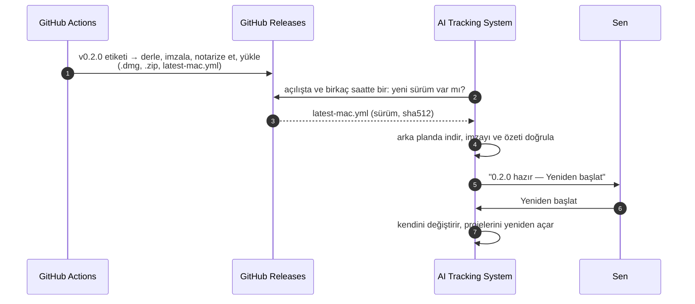
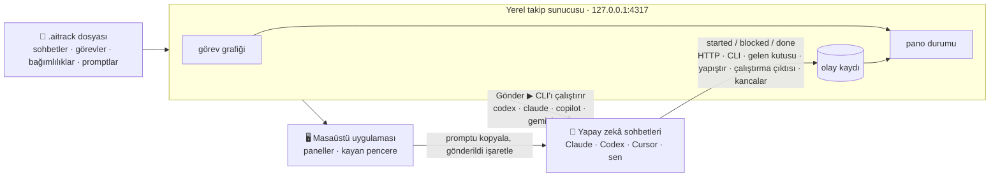
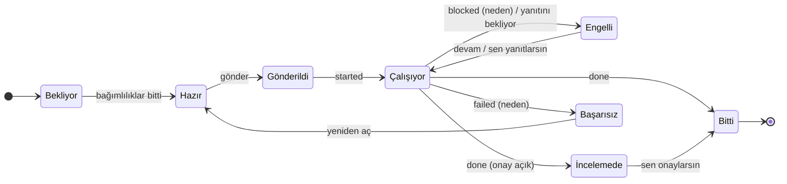

<div align="center">


# AI Tracking System

**Birden çok yapay zekâ sohbetini paralel yürütmek için kontrol masası.**
Planı bir kez yaz, yeşil görevleri gönder, panonun kendi kendine ilerlemesini izle.


[English](README.md) · **Türkçe**

<picture>
  <source media="(prefers-color-scheme: light)" srcset="docs/images/hero-light.png">
  
</picture>

</div>

> [!TIP]
> **Bütün fikir tek satırda:** bir görev, bağlı olduğu her şey bitince ve sohbeti boştayken **yeşil** yanar. Gönder: promptu o sohbete yapıştır ya da Codex / Claude Code / Copilot / Gemini sohbetinin **kendi kendine çalıştırmasına** bırak. Sohbet geri bildirir, pano ilerler, sıradaki görevler yeşile döner.

<details>
<summary><b>İçindekiler</b></summary>

- [Hareket halinde](#-hareket-halinde)
- [Kendi kendine çalışan sohbetler](#-kendi-kendine-çalışan-sohbetler)
- [Kurulum](#-kurulum)
- [Güncelleme](#-güncelleme)
- [Otomatik güncelleme: nasıl ekleriz](#-otomatik-güncelleme-nasıl-ekleriz)
- [Nasıl çalışır](#-nasıl-çalışır)
- [Sohbetten bildirim](#-sohbetten-bildirim)
- [`.aitrack` dosyası](#-aitrack-dosyası)
- [Kendine göre ayarla](#-kendine-göre-ayarla)
- [Komutlar](#-komutlar)
- [Güvenlik](#-güvenlik)
- [Sık sorulanlar](#-sık-sorulanlar)

</details>

## 🎬 Hareket halinde

### Pano kendini günceller

İki sohbet ilk görevlerini alıyor, geri bildiriyor ve sıradaki görevler kendiliğinden yanıyor.


<details>
<summary>Bu kayıtta ne oluyor</summary>

1. **T-01** ve **T-02** yeşil: hiçbir şeye bağlı değiller ve sohbetleri boşta.
2. Yeşil göreve tıklayınca açılan panelde görevin **hangi sohbete** verileceği ve **tam prompt** var: ortak bağlam, görev, izinli klasörler, kabul kriteri ve nasıl bildirileceği.
3. **Promptu kopyala ve gönderildi işaretle** promptu panoya alır; görev *Gönderildi*'ye geçer.
4. Sohbetler önce `started`, sonra `done` bildirir. **T-03**, **T-04** ve **T-05** açılır, yeşile döner.
5. Bir sohbet nedeniyle birlikte `blocked` bildirir; kart kırmızıyla nedeni gösterir, sana bildirim gelir.

</details>

### Kendi kendine çalışan sohbetler

Otomatik dağıtım açılıyor: boştaki sohbetler hazır görevlerini alıyor, çıktıları canlı akıyor, Claude bir soru soruyor ve görev panelinden yanıtını alıyor, biten işler sıradaki görevleri açıyor — onlar da kendiliğinden başlıyor.


### Kayan pencere

<table>
<tr>
<td width="300"></td>
<td>

**Bütün uygulamaların üstünde duran** küçük cam pencere: editörün, Codex uygulaması, Claude… Her masaüstünde görünür.

- her sohbetin şu an ne yaptığı
- **senden bekleyenler**: gönderilecek görevler, onaylar, engeller
- **tek tıkla** sıradaki promptu kopyala ve gönderildi işaretle
- sohbete ya da göreve tıkla, ana pencerede açılsın
- görünümler: **Genel**, **Kompakt liste**, **Mini şeritler**; bölümleri ve sohbetleri seç, üstte tut, saydamlığı ayarla

Kenar çubuğundan ya da <kbd>⇧</kbd><kbd>⌘</kbd><kbd>F</kbd> ile açılır.

</td>
</tr>
</table>

### Kendine göre ayarla

Ekranlar **panellerden** oluşur. Ekle, sürükle, boyutlandır, sohbete göre süz, birden çok düzen kaydet; temayı ve vurgu rengini seç.


## 🤖 Kendi kendine çalışan sohbetler

Bir sohbeti bir kez ayarla (şeridindeki **⚙ elle** rozeti); artık **Gönder** görevi doğrudan ona verir — kopyala-yapıştır yok.

| | |
| --- | --- |
| **Çalıştıran** | Codex CLI · Claude Code · GitHub Copilot CLI · Gemini CLI · herhangi bir komut (Cursor CLI, Aider, betikler) |
| **Nerede** | projenin deposunda ya da sohbete özel bir klasörde (birden fazla sohbet kod değiştiriyorsa git worktree) |
| **Erişim** | salt okunur · dosya düzenleme (varsayılan) · tam erişim |
| **Sohbet** | açık tuttuğun bir sohbet gibi aynı oturumda devam eder — ya da her görevde yeni oturum. Var olan bir oturumun kimliğini yapıştırırsan tam *o* sohbet devam eder. |
| **Durum** | ilk çıktıda *başladı*, sondaki rapordan *bitti*, ajan bir şey sorunca **yanıtını bekliyor** — **Yanıtla** ile cevap ver |
| **Canlı** | komutlar, düzenlemeler ve mesajlar görev paneline akar; istediğin an **Durdur** |
| **Otomatik dağıtım** | başlıktaki anahtar: boştaki sohbetler en acil hazır görevlerini alır, aynı anda en fazla *N* tane |
| **Kendi açtığın oturumlar** | Claude Code ve Codex için tek satırlık bir kanca, sen çalışırken görevleri *çalışıyor* ve *yanıtını bekliyor* olarak işaretler |

> [!IMPORTANT]
> CLI'lar senin bilgisayarında, **kendi girişin ve planınla** çalışır. Çalıştırma ayarları `~/.aitrack/runners.json` dosyasında kalır, proje dosyasına asla yazılmaz; ajan başlatmak uygulamanın denetim anahtarını ister — paylaşılan bir `.aitrack` dosyası ya da bir web sayfası hiçbir şey başlatamaz. İnsan gerektiren görevleri (ödeme, kimlik doğrulama, yasal onay) elle çalıştırdığın bir sohbette tut.

Her şey — CLI başına komutlar, erişim düzeyleri, oturumlar, kancalar, API: **[docs/agent-runners.md](docs/agent-runners.md)** (İngilizce).

## 📦 Kurulum

> [!NOTE]
> Uygulamayı derlemek için **Node.js 22.12+** gerekir. Kurulan uygulama Node.js'e ihtiyaç duymaz.

<details open>
<summary><b>macOS — çift tıkla kur</b></summary>

1. Repoyu klonla (Terminal ya da GitHub Desktop):
   ```bash
   git clone https://github.com/mitradeniz/ai-tracking-system.git
   ```
2. Finder'da klasörü aç ve **`install-macos.command`** dosyasına çift tıkla.
3. Açılan Terminal penceresi uygulamayı derler, **AI Tracking System**'i Applications ve Launchpad'e koyar ve açar.

Bundan sonra herhangi bir `.aitrack` dosyasına çift tıklamak onu uygulamada açar.

> [!IMPORTANT]
> macOS kurulum dosyasının açılamayacağını söylerse bir kez **sağ tık → Aç** de. Uygulama kendi bilgisayarında ad hoc imzalanır, Developer ID ile değil; yani indirilip paylaşılmak için değil, senin bilgisayarın için.

</details>

<details>
<summary><b>Windows ve Linux</b></summary>

```bash
npm install
npm run dist        # kurulum dosyaları apps/desktop/release/ içinde (.exe, .AppImage)
```

Derlemeler imzalı değildir; Windows'ta *Ek bilgi → Yine de çalıştır* de.

</details>

<details>
<summary><b>Kaynaktan çalıştır ya da tarayıcı sekmesinde aç</b></summary>

```bash
npm install
npm run desktop                                   # derle ve masaüstü uygulamasını başlat
npm run serve -- examples/landing-page.aitrack    # aynı arayüz http://127.0.0.1:4317 adresinde
```

</details>

**İlk adımlar:** uygulamayı aç → **Proje ekle → Seç…** → `examples/landing-page.aitrack` (ya da kendi reponda bir `.aitrack` dosyası).

## 🔄 Güncelleme

| | Nasıl |
| --- | --- |
| **macOS** | **`update-macos.command`** dosyasına çift tıkla. GitHub'dan son sürümü çeker, yenisi varsa uygulamayı yeniden kurar. Projelerin ve görev durumların korunur. |
| **Terminal** | `git pull`, ardından `install-macos.command`'a yeniden çift tıkla (ya da `npm run update:mac`). |
| **Windows / Linux** | `git pull && npm install && npm run dist`, sonra yeni kurulum dosyasını kur. |

<details>
<summary>Güncelleyici bir şeyi değiştirmeden önce neye bakar</summary>

- Klasör temiz bir git klonu olmalı. Değişen tek dosya `package-lock.json` ise (npm bazı makinelerde onu yeniden yazar) geri alınır, çünkü kurulum her zaman repodaki kilit dosyasını kullanır.
- Başka bir yerel değişiklik varsa güncelleme durur ve commit'lemeni ya da stash'lemeni söyler.
- Bulunduğun dal GitHub'daki bir dalı (genelde `main`) izlemeli ve güncelleme ileri sarma (fast-forward) olmalı; hiçbir şey birleştirilmez ya da üzerine yazılmaz.
- Zaten güncelsen hiçbir şey yeniden derlenmez.

</details>

## 🚀 Otomatik güncelleme: nasıl ekleriz

Bugün güncelleme tek çift tıklama. Uygulama içi gerçek güncelleme ("Yeni sürüm hazır — yeniden başlat") yol haritasında. Plan şu:



- [ ] **Sürüm hattı** — sürüm etiketlerinde `electron-builder --publish always` çalıştıran, kurulum dosyalarını ve `latest*.yml` güncelleme bildirimlerini GitHub Releases'e yükleyen bir GitHub Actions iş akışı.
- [ ] **Kod imzalama** — macOS'ta Apple Developer ID + notarization (macOS güncelleyicisi yalnızca imzalı sürümleri kurar), Windows'ta Authenticode. Sırlar GitHub'ın şifreli secrets alanında durur, repoya asla girmez.
- [ ] Masaüstü kabuğunda **`electron-updater`** — açılışta ve birkaç saatte bir kontrol, arka planda indirme, doğrulama ve *Güncellemek için yeniden başlat*; süren bir işi asla bölmez.
- [ ] **Arayüzde güncelleme şeridi** — sürüm, değişiklik notları, *Yeniden başlat* / *Sonra*; kontrolleri kapatma ayarı.
- [ ] **Kanallar** — `stable` ve `beta`, ayarlardan seçilir.
- [ ] **İmzalama gelene kadar** — GitHub Releases API'sine bakıp yalnızca yeni sürüm olduğunu *söyleyen* ve `update-macos.command`'a yönlendiren hafif bir kontrol.

## 🧭 Nasıl çalışır



1. **Planla.** `.aitrack` dosyası sohbetleri, görevleri gerçek bağımlılıklarıyla ve promptları içerir. Elle yaz ya da planından bir yapay zekâya yazdır: [Yapay zekâyla proje dosyası hazırlama](docs/authoring-with-ai.md).
2. **Aç.** Uygulama dosyayı doğrular (bilinmeyen kimlikler, döngüler, eksik promptlar) ve grafiğe döker.
3. **Oturumları başlat.** Her sohbetin şeridinde **Oturum promptu**'nu bir kez kopyala.
4. **Dağıt.** Yeşil görevleri gönder — elle, kendi kendine çalışan sohbetler için **Gönder ▶** ile ya da **otomatik dağıtıma** bırakarak.
5. **İzle.** Sohbetler çalıştıkça bildirir; bağlı görevler açılır; engelli görevler nedenini söyler.
6. **Paylaş.** **Dışa aktar** planı, istersen durum anlık görüntüsüyle birlikte commit'leyebileceğin bir dosyaya yazar.

<details>
<summary><b>Görevin yaşam döngüsü</b></summary>



| Durum | Anlamı |
| --- | --- |
| Bekliyor | Bağımlılıklardan bazıları henüz bitmedi. |
| Hazır / **Şimdi gönder** | Bağımlılıklar bitti ve uygun bir sohbette yer var. Yeşil. |
| Hazır, sohbet meşgul | Bağımlılıklar bitti ama uygun her sohbet `maxParallel` sınırında. |
| Gönderildi | Görevi bir sohbete verdin (kopyaladın ya da çalıştırmasını başlattın); henüz başlamadı. |
| Çalışıyor | Sohbet `started` ya da `progress` bildirdi. |
| Engelli | Sohbet nedeniyle birlikte `blocked` bildirdi ya da sana bir şey sormak için durdu (*yanıtını bekliyor*). Sohbeti meşgul tutar. |
| İncelemede | Onayını bekliyor (`requireApproval` açık ya da sohbet `review` bildirdi). |
| Bitti | `done` bildirildi (onay gerekiyorsa onaylandı). Bağlı görevleri açar. |
| Başarısız | Sohbet nedeniyle birlikte vazgeçti. Yeniden açıp tekrar gönderebilirsin. |

Her durumu görev panelinden elle de değiştirebilirsin.

</details>

## 📡 Sohbetten bildirim

Her promptun sonunda kısa bir **REPORTING** bölümü vardır; sohbetler ek kurulum olmadan nasıl bildireceğini bilir. Kanallar, tercih sırasıyla:

| Kanal | Ne zaman |
| --- | --- |
| **HTTP** `POST /api/report` | Sohbet senin bilgisayarında çalışıyorsa. |
| **CLI** `aitrack-report --task T-03 --status done` | Aynısı, ulaşamazsa gelen kutusuna kendisi düşer. |
| **Gelen kutusu dosyası** `.aitrack/inbox/<görev>-<durum>-<ms>.json` | Sohbet localhost'a ulaşamayan bir sanal ortamda çalışıyorsa. Git worktree'leri de taranır. |
| ` ```aitrack-report ` bloğunu **yapıştır** | Diskine ulaşamayan bulut sohbetleri için. |
| **Çalıştırma çıktısı** | [Kendi kendine çalışan](docs/agent-runners.md) sohbetler: son mesajın sonundaki blok kendiliğinden okunur. |
| **Kancalar** | Kendi açtığın Claude Code ve Codex oturumları: tur başı ve sonu. |

Ayrıntılar ve rapor şeması: [docs/agent-reporting.md](docs/agent-reporting.md).

## 📄 `.aitrack` dosyası

<details>
<summary>Küçük bir örnek</summary>

```json
{
  "$schema": "https://raw.githubusercontent.com/mitradeniz/ai-tracking-system/main/schema/aitrack.schema.json",
  "format": "aitrack",
  "version": 1,
  "project": { "id": "landing-page", "name": "Landing page" },
  "agents": [
    { "id": "claude-a", "name": "Claude A", "tool": "claude", "bootstrapPrompts": ["context"] },
    { "id": "codex-a", "name": "Codex A", "tool": "codex", "bootstrapPrompts": ["context"] }
  ],
  "tasks": [
    { "id": "T-01", "title": "API contract", "agent": "claude-a", "prompts": ["contract"] },
    { "id": "T-02", "title": "Page against the mock", "agent": "codex-a", "dependsOn": ["T-01"],
      "instructions": "Build the page using the mock server.", "allowedPaths": ["src/"] }
  ],
  "prompts": {
    "context": { "title": "Shared context", "body": "You are working on …" },
    "contract": { "title": "Contract", "body": "Write contracts/openapi.yaml …" }
  }
}
```

</details>

Tam başvuru: [docs/file-format.md](docs/file-format.md) · JSON Schema: [`schema/aitrack.schema.json`](schema/aitrack.schema.json) · doğrulama: `npm run validate -- yol/proje.aitrack`.

**Yeni proje mi?** Planını [bu yönergeyle](docs/authoring-with-ai.md) birlikte bir yapay zekâya ver, cevabı o repoda `<proje>.aitrack` olarak kaydet, doğrula ve **Proje ekle**.

## 🎨 Kendine göre ayarla

| | |
| --- | --- |
| **Paneller** | Şimdi gönderilebilir · Sohbet şeritleri · Akış · Liste · Senden bekleyenler · Son olaylar · İlerleme. Ekle, sürükle, boyutlandır (¼'ten tam genişliğe, otomatikten ekran boyuna) ve her birini belirli sohbetlerle sınırla. |
| **Düzenler** | İstediğin kadar: *Sabah*, *Sadece Claude*, *İnceleme saati*. Hazır gelenler: Sohbetler, Genel bakış, Akış, Liste. |
| **Sohbetler** | Şeritlerin sonunda **+ Sohbet ekle**, şeritteki ✏️ ile düzenle ya da kaldır. Yeni sohbet meşgul sohbetlerin görevlerini devralabilir. |
| **Görünüm** | Tema (koyu, açık, sistem), vurgu rengi, yoğunluk, yazı boyutu, cam yoğunluğu, dil (Türkçe, English). |
| **Cam** | macOS'ta pencere yarı saydamdır ve arkasında ne varsa onun tonunu alır; kayan pencere de öyle. |

## 🧰 Komutlar

| Komut | Ne yapar |
| --- | --- |
| `npm run desktop` | Her şeyi derler ve masaüstü uygulamasını başlatır. |
| `npm run serve -- [dosyalar…]` | Takip sunucusu ve web arayüzü `127.0.0.1:4317`'de (`--port`, `--data-dir`). Tarayıcıdan sohbet çalıştırmak için denetim anahtarlı bir bağlantı yazar. |
| `npm run dev:web` | Geliştirme: yeniden yüklenen sunucu + Vite geliştirme sunucusu. |
| `npm run dist` | electron-builder ile kurulum dosyaları üretir. |
| `npm run install:mac` / `npm run update:mac` | Kurulum / güncelleme dosyasına çift tıklamakla aynı. |
| `npm test` · `npm run typecheck` | Testler (Vitest) ve TypeScript denetimi. |
| `npm run validate -- <dosyalar…>` | `.aitrack` dosyalarını doğrular. |
| `npm run schema` | JSON Schema'yı zod şemasından yeniden üretir. |

Ortam değişkenleri: `AITRACK_PORT` (varsayılan `4317`), `AITRACK_DATA_DIR` (varsayılan `~/.aitrack`), `AITRACK_SERVER` (rapor CLI'ı).

<details>
<summary>Repo yapısı</summary>

```text
packages/core       dosya biçimi (zod), görev grafiği, pano mantığı, prompt üretimi, dosya düzenleme — G/Ç yok
packages/server     yerel takip sunucusu: kayıt, olay günlüğü, gelen kutusu izleyici, ajan çalıştırıcıları ve kancalar, HTTP API, SSE
packages/ui         React arayüzü: paneller, düzenler, kayan pencere, görünüm; Türkçe ve İngilizce
packages/reporter   ajanlar için aitrack-report CLI, bağımlılıksız
apps/desktop        Electron kabuğu: sunucu, yarı saydam pencereler, kayan pencere, .aitrack ilişkilendirmesi
schema/             üretilmiş JSON Schema
examples/           örnek projeler
docs/               dosya biçimi, bildirim, yapay zekâyla hazırlama, görseller
```

</details>

## 🔒 Güvenlik

- Sunucu **yalnızca 127.0.0.1**'i dinler, yabancı `Host` başlıklarını (DNS rebinding) ve başka kaynaklardan gelen yazma isteklerini reddeder, yazmalarda `application/json` ister.
- Pencereler context isolation ve sandbox ile çalışır; yerel köprü dosya pencereleri, kayan pencere ve denetim anahtarıyla sınırlıdır, her çağrı ana süreçte denetlenir.
- Ajan başlatmak bir **denetim anahtarı** ister (`~/.aitrack/control-token`); çalıştırma ayarları yalnızca senin bilgisayarında durur, proje dosyalarına yazılmaz.
- Raporlar veridir: görev durumunu değiştirir ve metin olarak gösterilir, asla çalıştırılmaz.
- `.aitrack` dosyalarına ve raporlara sır yazma; dosya commit'lenmek için var.

Daha fazlası: [SECURITY.md](SECURITY.md).

## ❓ Sık sorulanlar

<details>
<summary><b>Claude ya da Codex'le benim yerime konuşuyor mu?</b></summary>

İstersen evet. Kendi kendine çalışacak şekilde ayarlanan bir sohbet resmî CLI'ıyla — Codex CLI, Claude Code, GitHub Copilot CLI, Gemini CLI ya da kendi komutun — senin girişinle başlatılır; oturum görevler boyunca devam eder ve uygulamadan yanıt verebilirsin. Elle çalıştırdığın sohbetler kopyala-yapıştırla çalışmaya devam eder ve kancalarla bildirebilir. Bkz. [docs/agent-runners.md](docs/agent-runners.md).

</details>

<details>
<summary><b>Verilerim nerede?</b></summary>

Plan senin `.aitrack` dosyandır. Durum olayları bilgisayarında `~/.aitrack/events/`, çalıştırma ayarları `~/.aitrack/runners.json`, çalıştırma çıktıları `~/.aitrack/runs/` altındadır. Düzenler ve görünüm uygulamada saklanır. Takip sunucusu kendisi hiçbir yere bir şey göndermez; yapay zekâ sohbetlerine verdiğin promptlar o sohbetlerle birlikte bilgisayarından çıkar.

</details>

<details>
<summary><b>Aynı anda birden çok proje açık olabilir mi?</b></summary>

Evet. Her proje kendi reposundaki bir `.aitrack` dosyasıdır; kenar çubuğu hepsini listeler, kayan pencere istediğini izleyebilir.

</details>

<details>
<summary><b>Sohbetim bulutta çalışıyor, localhost'a ulaşamıyor.</b></summary>

Sohbet diskindeki bir worktree'de çalışıyorsa gelen kutusu dosyasını kullan; değilse her promptun sonunda istenen `aitrack-report` bloğunu **Rapor yapıştır** ile ekle.

</details>

---

<div align="center">

Sürüm 0.1 · dosya biçimi sürümlüdür ve aynı ana sürüm içinde geriye uyumlu kalır · [Katkı](CONTRIBUTING.md) · [Değişiklikler](CHANGELOG.md)

</div>
