<div align="center">

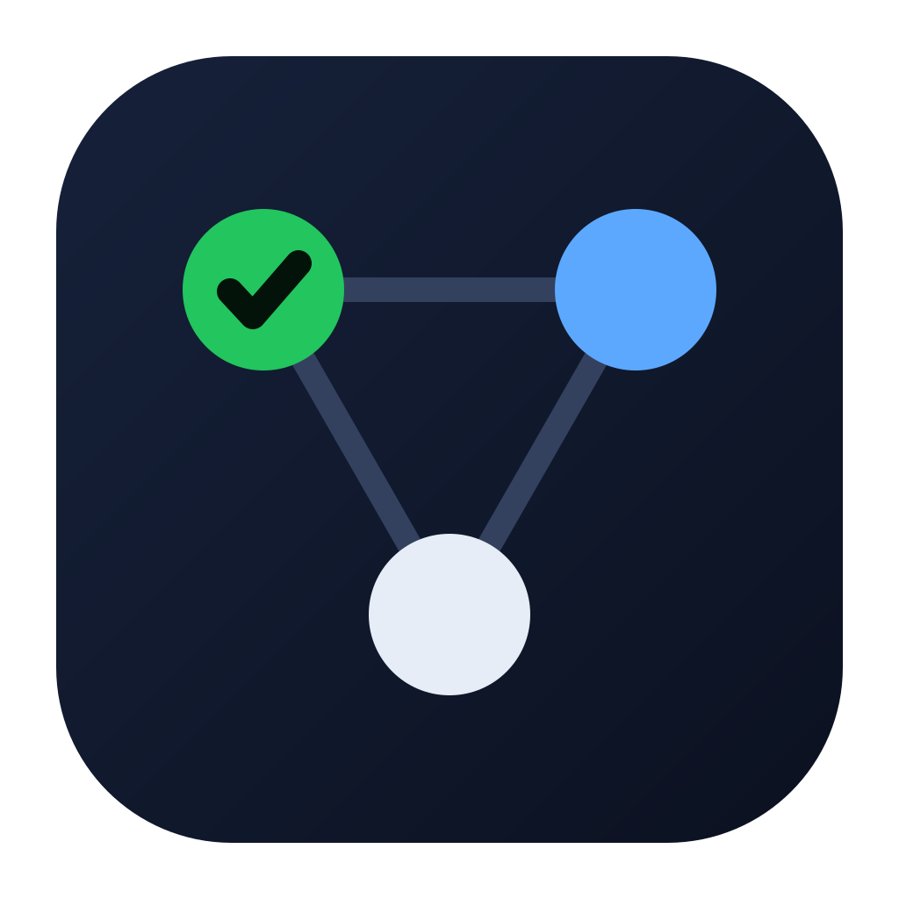

# AI Tracking System

**Birden çok yapay zekâ kod sohbetini paralel yürütmek için kontrol masası.**
Planı bir kez yaz, yeşil görevleri gönder — ya da sohbetlerin kendi kendine çalışmasına bırak — ve panonun ilerlemesini izle.


[English](README.md) · **Türkçe**

<picture>
  <source media="(prefers-color-scheme: light)" srcset="docs/images/hero-light.png">
  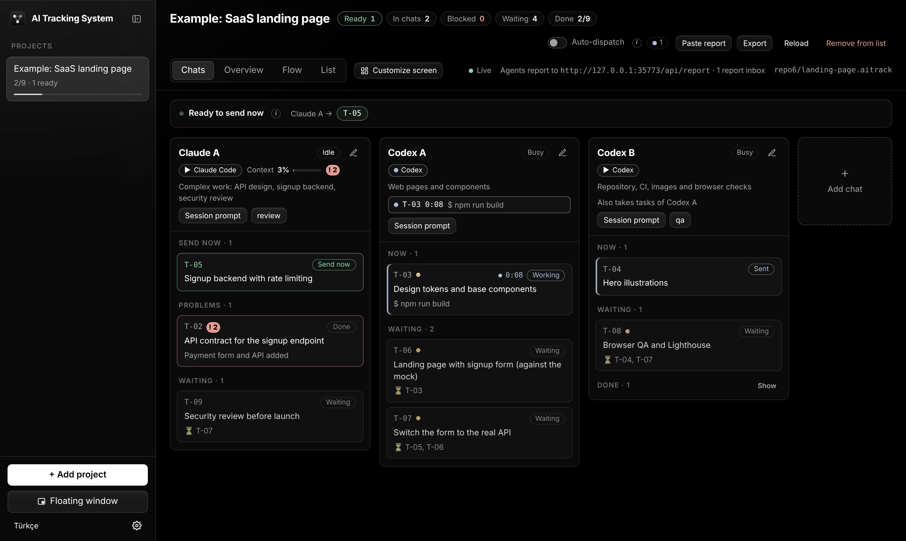
</picture>

</div>

> [!TIP]
> **Bütün fikir tek satırda:** bir görev, bağlı olduğu her şey bitince ve sohbeti boştayken **yeşil** yanar. Gönder: promptu o sohbete yapıştır ya da Codex / Claude Code / Copilot / Gemini sohbetinin **kendi kendine çalıştırmasına** bırak. Sohbet geri bildirir, pano ilerler, sıradaki görevler yeşile döner. Bir şey ters giderse görev, gönderilmeye hazır bir çözüm promptuyla birlikte kırmızı **!** alır.

<details>
<summary><b>İçindekiler</b></summary>

- [Neler var](#-neler-var)
- [Hareket halinde](#-hareket-halinde)
- [Kurulum](#-kurulum)
- [Güncellemeler](#-güncellemeler)
- [Proje başlat](#-proje-başlat)
- [Planı uygulamada düzenle](#%EF%B8%8F-planı-uygulamada-düzenle)
- [Hızlı başlangıç](#-hızlı-başlangıç)
- [Kendi kendine çalışan sohbetler](#-kendi-kendine-çalışan-sohbetler)
- [Sorunlar, çalıştırma bilgileri ve kendi promptların](#-sorunlar-çalıştırma-bilgileri-ve-kendi-promptların)
- [Nasıl çalışır](#-nasıl-çalışır)
- [Sohbetten bildirim](#-sohbetten-bildirim)
- [`.aitrack` dosyası](#-aitrack-dosyası)
- [Kendine göre ayarla](#-kendine-göre-ayarla)
- [Klavye kısayolları](#%EF%B8%8F-klavye-kısayolları)
- [Komutlar](#-komutlar)
- [Verilerin nerede](#-verilerin-nerede)
- [Güvenlik](#-güvenlik)
- [Sık sorulanlar](#-sık-sorulanlar)
- [Yol haritası](#%EF%B8%8F-yol-haritası)

</details>

## ✨ Neler var

| | |
| --- | --- |
| 🆕 **Yeni proje sihirbazı** | Klasörü, sohbetleri (bilgisayarındaki yapay zekâ CLI'larından önerilir) ve nasıl planlanacağını seç: Claude Code ya da Codex planından görevleri yazsın, başka bir yapay zekâ kopyala-yapıştırla yazsın ya da boş başla. JSON yazmak yok. |
| ✏️ **Plan düzenleyici** | Görevleri ve promptları uygulamada ekle, değiştir, kaldır: görevi hangi sohbetin alacağı, neyi beklediği, talimatı, izinli yolları ve kabul kriteri. |
| 🟢 **Sırada ne olduğunu bilen pano** | Görevler, bağlı oldukları işler bitince ve sohbetlerinde yer varken açılır. *Şimdi gönderilebilir* yeşil olanları tek bakışta gösterir; diğer her görev neden beklediğini söyler. |
| 🤖 **Kendi kendine çalışan sohbetler** | Codex CLI, Claude Code, GitHub Copilot CLI, Gemini CLI ya da herhangi bir komut görevi kendi oturumunda, senin reponda çalıştırır. Çıktı canlı akar; yanıtlamak ve durdurmak uygulamadan. |
| ⚡ **Otomatik dağıtım** | Tek anahtar: boştaki sohbetler, en acil hazır görevlerini yeşile döner dönmez alır; aynı anda en fazla *N* tane. |
| ❗ **Sade bir dille sorunlar** | Sohbetin yapamadığı, atladığı ya da senden beklediği şeyler her yerde kırmızı **!** ile işaretlenir, senin dilinde açıklanır ve düzenlemeye, kopyalamaya ya da göndermeye hazır bir çözüm promptuyla gelir. |
| ⏱️ **Çalıştırma bilgileri** | Geçen süre, araç çağrıları, tokenlar, turlar, liste fiyatı ve oturumun bağlamının ne kadar dolu olduğu — canlı. |
| ✍️ **Kendi promptların** | Gönderirken talimat ekle, sohbetin oturumuna istediğin an yaz, kayıtlı promptlarını tut. |
| 🪟 **Kayan pencere** | Editörünün ve yapay zekâ uygulamalarının üstünde duran küçük pencere: her sohbetin ne yaptığı, senden bekleyenler, tek tıkla gönder. |
| 🧩 **Paneller ve düzenler** | Ekranları panellerden kur, sürükle, boyutlandır, sohbete göre süz, istediğin kadar düzen kaydet. |
| 🎨 **Siyah beyaz arayüz** | Yalnızca durumların renkli olduğu yüksek kontrastlı siyah tema (ve beyazı). Katlanan kenar çubuğu, her anahtarı açıklayan ⓘ ipuçları ve uygulamayı ilk açışta kısa bir tanıtım. |
| 📌 **Proje listen** | Projeleri en üste sabitle, sürükleyerek kendi sırana koy, listeden kaldır ya da dosyasını Çöp Kutusu'na taşı. |
| 🔄 **Tek tıkla güncelleme** | macOS'ta uygulama GitHub'ı kontrol eder ve kendini günceller: **Güncelle ve yeniden başlat**, ya da çalışan sohbet yokken yeni sürümü kendiliğinden kursun. |
| 🔌 **Her sohbetle çalışır** | Elle yürüttüğün sohbetler HTTP, bir CLI, bir gelen kutusu dosyası, yapıştırılan bir blok ya da tek satırlık bir kanca ile bildirir. |
| 🏠 **Önce yerel** | `127.0.0.1` üzerinde çalışır; hesap yok, telemetri yok. Plan, commit'lediğin bir dosyadır. |

## 🎬 Hareket halinde

### Pano kendini günceller

İki sohbet ilk görevlerini elle alıyor, geri bildiriyor ve sıradaki görevler yanıyor.

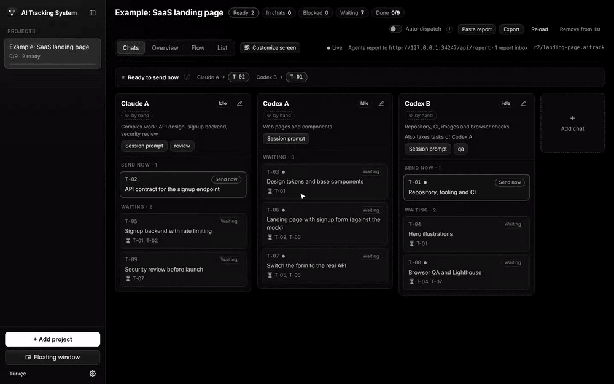

<details>
<summary>Bu kayıtta ne oluyor</summary>

1. **T-01** ve **T-02** yeşil: hiçbir şeye bağlı değiller ve sohbetleri boşta.
2. Yeşil göreve tıklayınca açılan panelde görevin **hangi sohbete** verileceği ve **tam prompt** var: ortak bağlam, görev, izinli klasörler, kabul kriteri ve nasıl bildirileceği.
3. **Promptu kopyala ve gönderildi işaretle** promptu panoya alır; görev *Gönderildi*'ye geçer.
4. Sohbetler önce `started`, sonra `done` bildirir. **T-03**, **T-04** ve **T-05** açılır, yeşile döner.
5. **T-04** gönderilir, sohbeti nedeniyle birlikte `blocked` bildirir; kart kırmızıya döner, sana bildirim gelir.

</details>

### Kendi kendine çalışan sohbetler

Otomatik dağıtım açılıyor: boştaki sohbetler hazır görevlerine başlıyor, komutları canlı akıyor, Claude Code bir soru soruyor ve görev panelinden yanıtını alıyor, biten işler sıradaki görevleri açıyor — onlar da kendiliğinden başlıyor.

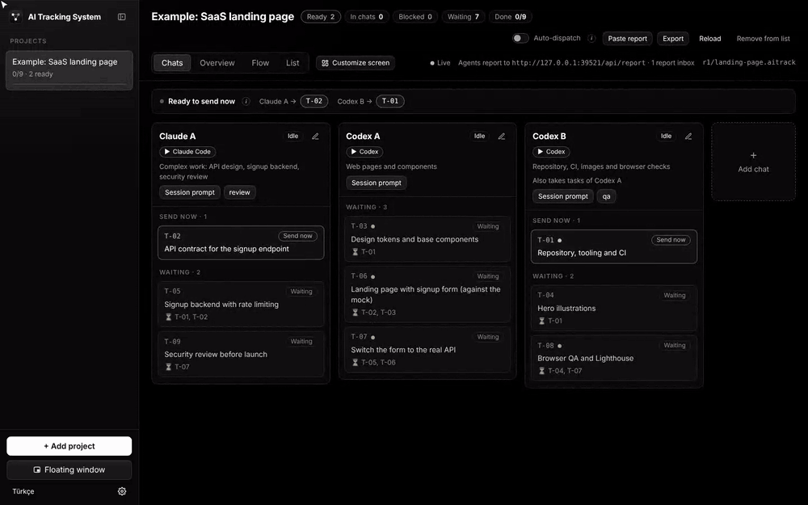

### Kayan pencere

<table>
<tr>
<td width="300">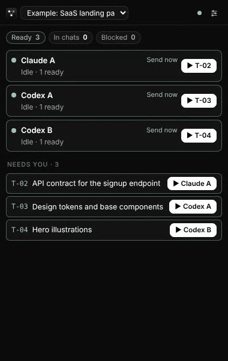</td>
<td>

**Bütün uygulamaların üstünde duran** küçük pencere: editörün, Codex uygulaması, Claude… Her masaüstünde görünür.

- her sohbetin şu an ne yaptığı, canlı komutu ve sayacıyla
- **senden bekleyenler**: gönderilecek görevler, yanıtlar, onaylar, engeller ve sorunlar (**!**)
- **tek tıkla** sıradaki görevi gönder — sohbetin çalıştırmasını başlatır, elle yürüttüğün sohbetlerde promptu kopyalar
- sohbete ya da göreve tıkla, ana pencerede açılsın
- görünümler: **Genel**, **Kompakt liste**, **Mini şeritler**; bölümleri ve sohbetleri seç, üstte tut, saydamlığı ayarla

Kenar çubuğundan, *Pencere* menüsünden ya da <kbd>⇧</kbd><kbd>⌘</kbd><kbd>F</kbd> ile açılır.

</td>
</tr>
</table>

### Kendine göre ayarla

Ekranlar **panellerden** oluşur. Ekle, sürükle, boyutlandır, sohbete göre süz, birden çok düzen kaydet; temayı ve vurgu rengini seç, kenar çubuğunu katla.

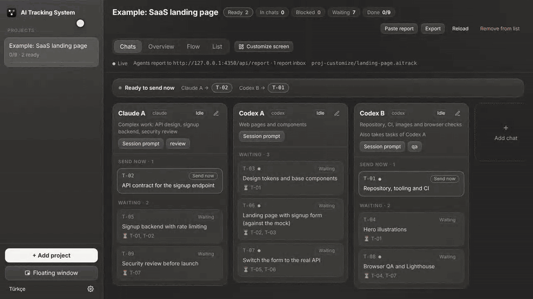

## 📦 Kurulum

| Gereken | Neden |
| --- | --- |
| **Node.js 22.12+** | Uygulamayı derlemek için. Kurulan uygulamanın Node.js'e ihtiyacı yok. |
| **git** | Repoyu klonlamak ve tek tıkla güncelleme için. macOS'ta: `xcode-select --install`. |
| Bir yapay zekâ CLI'ı *(isteğe bağlı)* | Kendi kendine çalışan sohbetler için giriş yapılmış `codex`, `claude`, `copilot` ya da `gemini`. Yoksa sohbetler kopyala-yapıştırla çalışır. |

<details open>
<summary><b>macOS — çift tıkla kur</b> (önerilen)</summary>

1. Repoyu klonla (Terminal ya da GitHub Desktop):
   ```bash
   git clone https://github.com/mitradeniz/ai-tracking-system.git
   ```
2. Finder'da klasörü aç ve **`install-macos.command`** dosyasına çift tıkla.
3. Açılan Terminal penceresi dört adımı yapar — **bağımlılıkları kur** (ilk seferde yaklaşık 150 MB'lık Electron iner) → **derle** → **bu Mac için paketle** → **kur** — ve uygulamayı açar.

Sonuç:

- **AI Tracking System** `/Applications` içinde (yazılamıyorsa `~/Applications`) ve Launchpad'de.
- Bir `.aitrack` dosyasına çift tıklamak onu uygulamada açar.
- Kurulum, uygulamanın hangi klondan derlendiğini hatırlar (`~/.aitrack/install.json`); böylece uygulama bundan sonra [kendini güncelleyebilir](#-güncellemeler).

> [!IMPORTANT]
> Klonladığın klasörü silme — güncellemeler orada çekilip derlenir. macOS kurulum dosyasının açılamayacağını söylerse bir kez **sağ tık → Aç** de. Uygulama kendi bilgisayarında ad hoc imzalanır, Developer ID ile değil; yani indirilip paylaşılmak için değil, senin bilgisayarın için.

</details>

<details>
<summary><b>Windows ve Linux</b></summary>

```bash
git clone https://github.com/mitradeniz/ai-tracking-system.git
cd ai-tracking-system
npm install
npm run dist        # kurulum dosyaları apps/desktop/release/ içinde (.exe, .AppImage)
```

Derlemeler imzalı değildir; Windows'ta *Ek bilgi → Yine de çalıştır* de.

</details>

<details>
<summary><b>Kaynaktan çalıştır ya da tarayıcı sekmesinde aç</b></summary>

```bash
npm install
npm run desktop                                   # derle ve masaüstü uygulamasını başlat
npm run serve -- examples/landing-page.aitrack    # aynı arayüz http://127.0.0.1:4317 adresinde
```

`serve` denetim anahtarını içeren bir bağlantı yazar; ajanları tarayıcıdan başlatmak için o bağlantıyı aç.

</details>

## 🔄 Güncellemeler

<table>
<tr>
<td width="380">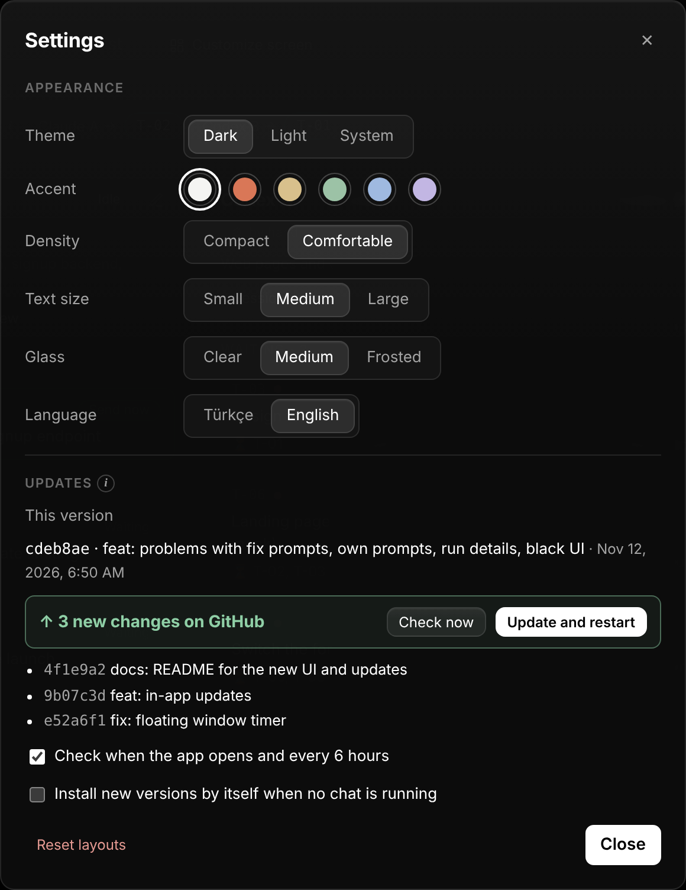</td>
<td>

**macOS'ta uygulama kendini günceller.** GitHub'da yeni bir sürüm olduğunda kenar çubuğunun altında **↑ Güncelleme var** görünür.

1. Ona tıkla — ya da **Ayarlar → Güncellemeler**'i veya menü çubuğunda **AI Tracking System → Güncellemeleri Denetle…**'yi aç.
2. Bu sürümü ve yeni değişiklikleri görürsün, her commit için bir satır.
3. **Güncelle ve yeniden başlat**'a tıkla.

Yeni sürüm hazırlanırken (birkaç dakika) uygulama çalışmaya devam eder. Sonra kendini kapatır ve yeni sürümle *"… sürümüne güncellendi"* notuyla açılır. Projelerin, düzenlerin, çalıştırma ayarların ve görev durumların korunur.

**Otomatik seçenekler** (aynı yerde):

- **Uygulama açılınca ve 6 saatte bir kontrol et** — varsayılan olarak açık.
- **Çalışan sohbet yokken yeni sürümü kendiliğinden kur** — varsayılan olarak kapalı. Hiçbir ajan çalışmıyorken kurar; böylece hiçbir görev yarıda kesilmez.

</td>
</tr>
</table>

### Güncelleme nasıl işler

Ayrı bir indirme sunucusu yok: uygulama, kurulduğu git klonunu, senin de çift tıklayabileceğin aynı betiklerle günceller.

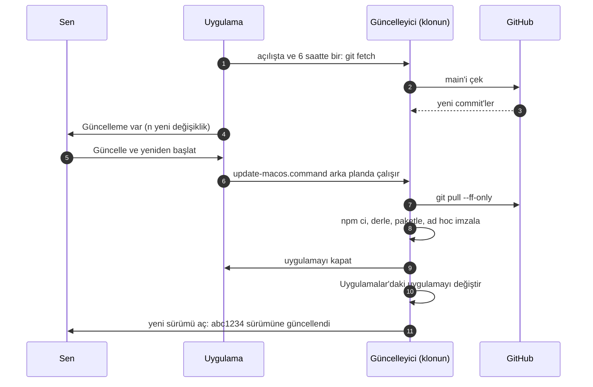

1. **Kontrol.** Uygulama klonunda `git fetch` çalıştırır ve dalını GitHub'da izlediği dalla (genelde `origin/main`) karşılaştırır. Kontrol hiçbir şeyi değiştirmez.
2. **Güncelleme.** **Güncelle ve yeniden başlat**, `update-macos.command`'ı arka planda `AITRACK_UNATTENDED=1` ile (soru sormadan) başlatır. Betik çeker (yalnızca ileri sarma) ve işi `install-macos.command`'a devreder.
3. **Yeniden derle ve değiştir.** Kurulum kilitli bağımlılıkları kurar, derler, bu Mac için paketler, çalışan uygulamayı kapatır, Uygulamalar'dakini değiştirir ve yeni sürümü açar.
4. **Geri bildirim.** İlerleme `~/.aitrack/update-status.json`'a, tam çıktı `~/.aitrack/update.log`'a yazılır; Güncellemeler bölümü son satırları canlı gösterir, yeni sürüm de güncellendiğini (ya da neden başarısız olduğunu) söyler.

> [!NOTE]
> **Çalışan sohbetler** uygulama yeniden başlarken durur. Çalışan varsa uygulama önce sorar. Yarıda kalan çalıştırmalar bir sonraki açılışta *engelli* işaretlenir; aynı oturumdan devam etmek için yanıtla ya da yeniden gönder.

### Bir şeyi değiştirmeden önce

- Klasör, dalı GitHub'daki bir dalı izleyen bir git klonu olmalı ve güncelleme **ileri sarma (fast-forward)** olmalı — hiçbir şey birleştirilmez, rebase edilmez ya da üzerine yazılmaz.
- Yerel değişiklikler güncellemeyi durdurur. Tek istisna yalnızca `package-lock.json`'ın değişmiş olması (npm bazı makinelerde onu yeniden yazar): kurulum her zaman repodaki kilit dosyasını kullandığı için geri alınır.
- Zaten güncelsen hiçbir şey yeniden derlenmez.

### Diğer güncelleme yolları

| | Nasıl |
| --- | --- |
| **macOS, çift tıkla** | Klondaki **`update-macos.command`** dosyasına çift tıkla. Düğmeyle aynı adımlar, bir Terminal penceresinde. |
| **macOS, Terminal** | `npm run update:mac` — ya da `git pull`, sonra `npm run install:mac`. |
| **Windows / Linux** | `git pull && npm install && npm run dist`, sonra yeni kurulum dosyasını kur. |
| **Kaynaktan** | `git pull && npm install && npm run desktop`. |
| **Tarayıcı sekmesi** | `git pull`, sonra `npm run serve`'ü yeniden başlat. |

<details>
<summary><b>Sorun giderme: Güncellemeler bölümünün sana söyleyebilecekleri</b></summary>

| Mesaj | Ne yapmalı |
| --- | --- |
| *Uygulama hangi klasörden kurulduğunu bilmiyor.* | Uygulama eski bir kurulum betiğiyle kurulmuş. Klonundaki `install-macos.command`'a bir kez çift tıkla; ondan sonra güncellemeler uygulamadan yapılır. |
| *git bulunamadı.* | Xcode Command Line Tools'u kur: `xcode-select --install`. |
| *GitHub'a ulaşılamadı.* | Bağlantını kontrol et ve **Şimdi kontrol et**'e yeniden bas. Hata mesajın altında görünür. |
| *Klonda yerel değişiklikler var.* | Değişen dosyalar listelenir. Commit'le ya da stash'le (`git stash`), sonra güncelle. |
| *Klondaki dal GitHub'daki bir dalı izlemiyor.* | Klonda `git switch main`. |
| *Hem senin klonunda hem GitHub'da yeni commit'ler var.* | Birleştirmek için klonda `git pull` çalıştır, sonra güncelle. |
| *n yerel commit henüz GitHub'da değil.* | Yalnızca bilgi: klonun GitHub'ın önünde (örneğin commit'ledin ama push'lamadın). |
| *Tek tıkla güncelleme macOS için.* / *Kaynaktan çalışıyor.* | Yukarıdaki tablodaki komutları kullan. |
| *Güncelleme başarısız: …* | `~/.aitrack/update.log`'u oku, nedeni düzelt (çoğunlukla eski Node.js ya da ağ yok) ve **Güncelle ve yeniden başlat**'a yeniden bas — ya da Terminal'de izlemek için `update-macos.command`'a çift tıkla. |

</details>

## 🆕 Proje başlat

<table>
<tr>
<td width="440">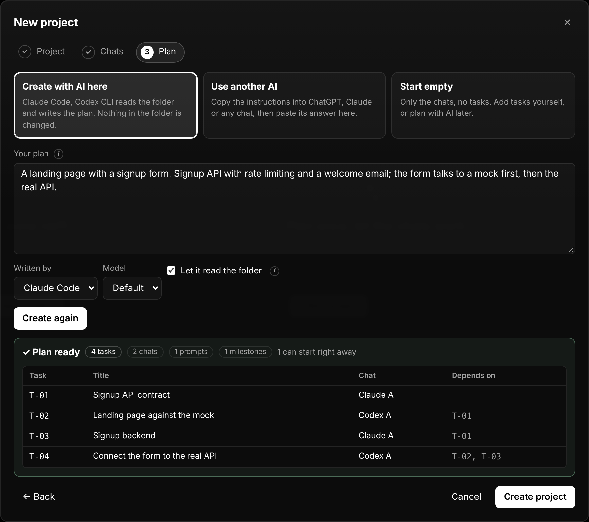</td>
<td>

Kenar çubuğunda **+ Yeni proje**'ye tıkla. Üç kısa adım:

1. **Proje** — bir ad ve klasör; genelde sohbetlerin çalışacağı reponun kökü. `<ad>.aitrack` dosyası oraya, kodun yanına kaydedilir. Klasörde zaten bir proje dosyası varsa onu açabilirsin. **Planın dilini** seç (English ya da Türkçe): başlıklar, promptlar ve sohbetlerin bildirdiği sorunlar bu dilde yazılır.
2. **Sohbetler** — projede çalışacak yapay zekâ sohbetleri. Sihirbaz bilgisayarında Claude Code, Codex, Copilot ve Gemini'yi arar ve **Claude A** ile **Codex A** önerir; daha fazlasını ekle (**+ Claude**, **+ Codex**, **+ Cursor** …), adlarını değiştir ve her birinin neyde iyi olduğunu yaz. İstersen CLI'ı kurulu sohbetler kendi kendine çalışsın.
3. **Plan** — birini seç:
   - **Burada yapay zekâyla oluştur** — ne yapılacağını anlat; Claude Code, Codex, Gemini ya da Copilot görevleri yazsın. Klasörde **salt okunur** çalışır: gerçekçi görevler ve yollar seçmek için kodu ve README'yi okuyabilir ama hiçbir şeyi değiştiremez. Genelde bir ile beş dakika sürer.
   - **Başka bir yapay zekâ kullan** — **Talimatı kopyala** (planın ve sohbetlerin dahil) ve ChatGPT'ye, Claude'a ya da herhangi bir sohbete yapıştır; cevabını geri yapıştır ve **Kontrol et**.
   - **Boş başla** — yalnızca sohbetler; görevleri kendin ekle.

Hiçbir şey kaydedilmeden önce planı görürsün: görevler, sohbetleri ve neyi bekledikleri. Yapay zekânın cevabındaki sorunlar (bilinmeyen sohbet, döngü) listelenir; tek tıkla **… düzeltsin**.

</td>
</tr>
</table>

> [!TIP]
> Uygulamayı ilk açtığında on adımlık bir tanıtım ekranın ana bölümlerini gösterir. **Ayarlar → Tanıtımı yeniden göster** ile tekrar açılır.

## ✏️ Planı uygulamada düzenle

<table>
<tr>
<td width="440">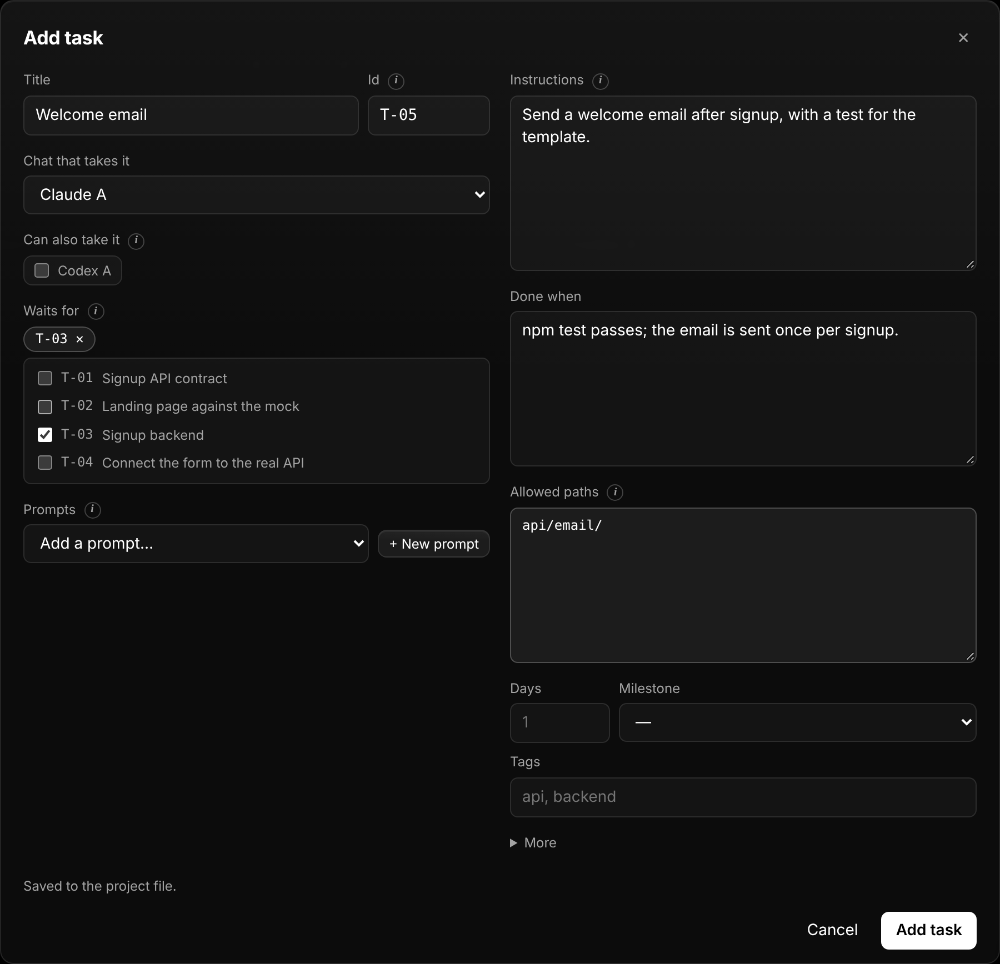</td>
<td>

| | |
| --- | --- |
| **Görev ekle** | Başlıktaki **+ Görev** ya da bir sohbet şeridinin altındaki **+ Görev**. |
| **Değiştir ya da kaldır** | Görevi aç → **Düzenle**. Şu an bir sohbette olan görev kaldırılamaz; kaldırılan görevi bekleyenler onun beklediklerini bekler. |
| **Neyi bekliyor** | Listeden görev seç; bu görevi zaten bekleyen bir görev seçilemez, böylece döngü olmaz. |
| **Promptlar** | Başlıktaki **Promptlar** kütüphaneyi açar: ortak bağlam, oturum promptları, görev promptları. Kaldırılan prompt onu kullanan görevlerden ve sohbetlerden de çıkarılır. |
| **Boş proje** | Pano **Yapay zekâyla planla**, **Görev ekle** ve **Promptlar** sunar. |
| **Proje ayarları** | ⋯ menüsü: ad, açıklama, planın dili ve biten görevlerin onayını bekleyip beklemeyeceği. |

Her değişiklik kontrol edilip `.aitrack` dosyasına biçimi korunarak yazılır: senin yazmadığın alanlar eklenmez, anahtar sırası kalır; diff küçük kalır.

</td>
</tr>
</table>

## 🚀 Hızlı başlangıç

1. **+ Yeni proje** — [sihirbaz](#-proje-başlat) klasörü, sohbetleri ve planı kurar. Uygulamayı önce denemek için yanındaki klasör düğmesiyle `examples/landing-page.aitrack`'i aç.
2. **Sohbetleri başlat.** Elle yürüttüğün bir sohbet için **Oturum promptu**'nu bir kez yeni bir Claude / Codex / Cursor sohbetine kopyala. Bir sohbetin kendi kendine çalışması için şeridindeki **⚙ elle** rozetine tıkla ve bir CLI seç ([aşağıda](#-kendi-kendine-çalışan-sohbetler)).
3. **Yeşil görevleri gönder.** Yeşil karta tıkla → **Promptu kopyala ve gönderildi işaretle** (elle) ya da **Gönder ▶** (kendi kendine). Ya da başlıktaki **Otomatik dağıtım**'ı aç.
4. **İzle.** Sohbetler `started`, `done`, `blocked` bildirir; bağlı görevler açılır. **Senden bekleyenler** yanıtları, onayları, engelleri ve sorunları toplar.
5. **Ekranda tut.** **Kayan pencere**'yi aç (<kbd>⇧</kbd><kbd>⌘</kbd><kbd>F</kbd>) ve editörüne dön.
6. **Planı paylaş.** **Dışa aktar** planı — istersen durum anlık görüntüsüyle — commit'leyebileceğin bir dosyaya yazar.

## 🤖 Kendi kendine çalışan sohbetler

Bir sohbeti bir kez ayarla — şeridindeki **⚙ elle** rozetine tıkla — artık **Gönder** görevi doğrudan ona verir: kopyala-yapıştır yok.

| | |
| --- | --- |
| **Çalıştıran** | Codex CLI · Claude Code · GitHub Copilot CLI · Gemini CLI · herhangi bir komut (Cursor CLI, Aider, betikler). Kurulu CLI'lar sürümleriyle birlikte kendiliğinden bulunur. |
| **Model ve düşünme düzeyi** | Yazılmaz, listeden seçilir: Codex'in model kataloğu ve her modelin düşünme düzeyleri, Copilot'un modelleri, Claude Code (`opus`, `sonnet`, `haiku`, `fable`) ve Gemini (`pro`, `flash`, …) için her zaman en güncel sürümü seçen takma adlar. **Diğer** herhangi bir model kimliğini alır; **Varsayılan** seçimi CLI'a bırakır. |
| **Nerede** | Projenin reposunda ya da sohbete özel bir klasörde (birden fazla sohbet kod değiştiriyorsa git worktree). |
| **Erişim** | Salt okunur · dosya düzenleme (varsayılan) · tam erişim. |
| **Sohbet** | Açık tuttuğun bir sohbet gibi aynı oturumda devam eder — ya da her görevde yeni oturum. Var olan bir oturumun kimliğini yapıştırırsan tam *o* sohbet devam eder. |
| **Durum** | İlk çıktıda *başladı*, sondaki rapordan *bitti*, ajan bir şey sorunca **yanıtını bekliyor** — **Yanıtla** ile cevap ver (<kbd>⌘</kbd><kbd>↵</kbd>). |
| **Canlı** | Komutlar, düzenlemeler ve mesajlar görev paneline akar; istediğin an **Durdur**. |
| **Otomatik dağıtım** | Başlıktaki anahtar: boştaki sohbetler en acil hazır görevlerini alır, aynı anda en fazla *N* çalıştırma. |
| **Kendi açtığın oturumlar** | Claude Code ve Codex için tek satırlık bir kanca, kendi açtığın bir oturumda çalışırken görevleri *çalışıyor* ve *yanıtını bekliyor* olarak işaretler. |

> [!IMPORTANT]
> CLI'lar senin bilgisayarında, **kendi girişin ve planınla** çalışır. Çalıştırma ayarları `~/.aitrack/runners.json` dosyasında kalır, proje dosyasına asla yazılmaz; ajan başlatmak uygulamanın denetim anahtarını ister — paylaşılan bir `.aitrack` dosyası ya da bir web sayfası hiçbir şey başlatamaz. İnsan gerektiren görevleri (ödeme, kimlik doğrulama, koşulları kabul etme) elle yürüttüğün bir sohbette tut.

Her şey — CLI başına komutlar, erişim düzeyleri, oturumlar, kancalar, API: **[docs/agent-runners.md](docs/agent-runners.md)** (İngilizce).

## ❗ Sorunlar, çalıştırma bilgileri ve kendi promptların

<table>
<tr>
<td width="380">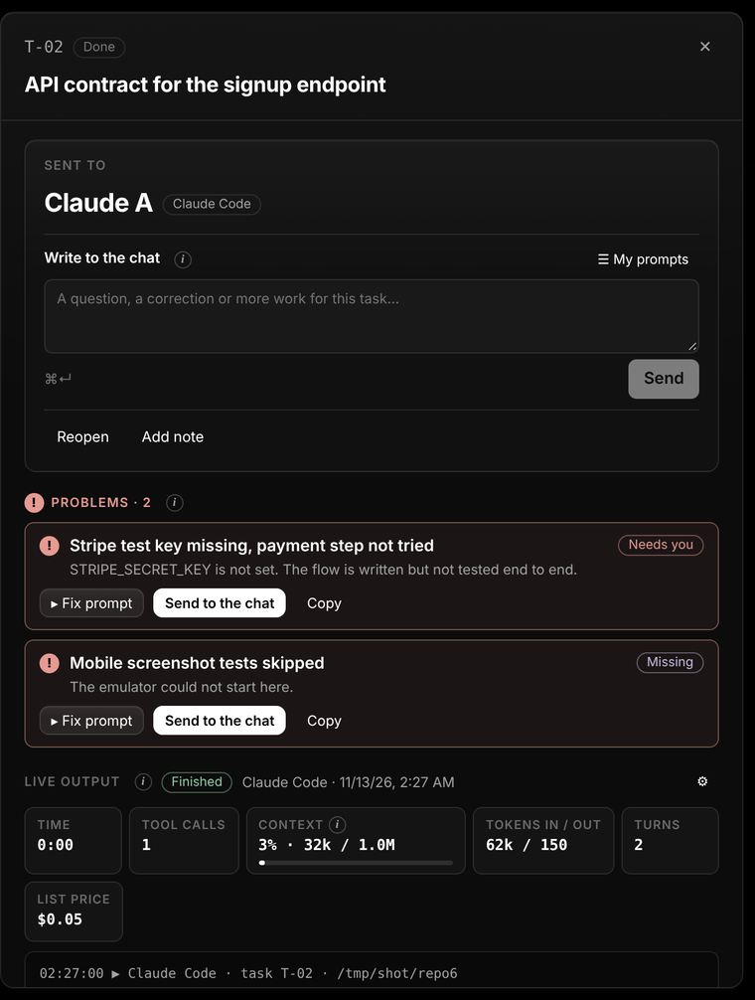</td>
<td>

**Sorunlar, sade bir dille.** Sohbet bir şeyi yapamadığında, atladığında ya da senden bir şey beklediğinde bunu raporunda — projenin dilinde — listeler. Görev kartlarda, şeritlerde, *Senden bekleyenler*'de ve kayan pencerede kırmızı **!** alır. Görev paneli her sorunu bir **çözüm promptuyla** gösterir: aç ve düzenle, kopyala ya da tek tıkla sohbete gönder. Hatalar, sohbetin beklediği sorular ve CLI'ın reddettiği araçlar da burada, çalıştırma ayarlarına kısayoluyla birlikte çıkar.

**Çalıştırma bilgileri.** Süre, giren ve çıkan tokenlar, araç çağrıları, turlar, liste fiyatı ve oturumun bağlam penceresinin ne kadar dolu olduğu (Claude Code bildirir) — şeritlerde, kartlarda, görev panelinde ve kayan pencerede.

**Kendi promptların.** Görevi gönderirken kendi talimatını ekle (plandan önce gelir), sohbetin oturumuna istediğin an yaz, tekrar kullandığın promptları **Promptlarım**'da tut.

</td>
</tr>
</table>

## 🧭 Nasıl çalışır

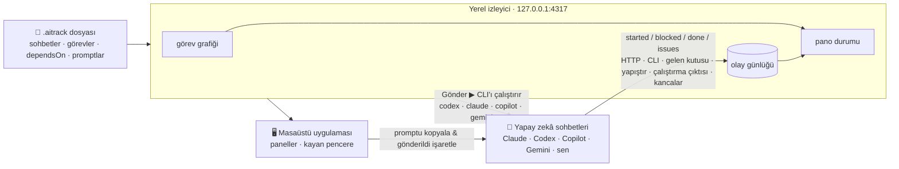

1. **Planla.** Bir `.aitrack` dosyası sohbetleri, gerçek bağımlılıklarıyla görevleri ve promptları listeler. Elle yaz ya da planından bir yapay zekâya yazdır — bkz. [Yapay zekâyla proje yazmak](docs/authoring-with-ai.md).
2. **Aç.** Uygulama dosyayı doğrular (bilinmeyen kimlikler, döngüler, eksik promptlar) ve bir grafik olarak dizer.
3. **Dağıt.** Yeşil görevleri gönder — elle, **Gönder ▶** ile ya da **otomatik dağıtım**la.
4. **İzle.** Sohbetler çalışırken bildirir; bağlı görevler açılır; engellenen görevler nedenini söyler; sorunlar **!** alır.
5. **Paylaş.** **Dışa aktar** planı, istersen durum anlık görüntüsüyle, commit'leyebileceğin bir dosyaya yazar.

<details>
<summary><b>Görevin yaşam döngüsü</b></summary>

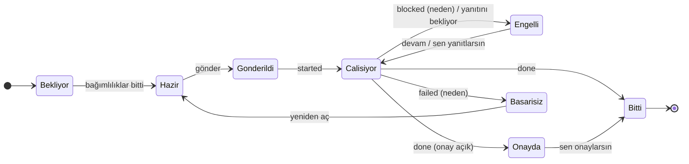

| Durum | Anlamı |
| --- | --- |
| Bekliyor | Bağımlılıklardan bazıları henüz bitmedi. |
| Hazır / **Şimdi gönder** | Bağımlılıklar bitti ve uygun bir sohbette yer var. Yeşil. |
| Hazır, sohbet meşgul | Bağımlılıklar bitti ama uygun her sohbet `maxParallel` sınırında. |
| Gönderildi | Görevi bir sohbete verdin (kopyaladın ya da çalıştırmasını başlattın); henüz başlamadı. |
| Çalışıyor | Sohbet `started` ya da `progress` bildirdi veya çalıştırması çıktı üretiyor. |
| Engelli | Sohbet nedeniyle `blocked` bildirdi ya da sana bir şey sormak için durdu (*yanıtını bekliyor*). Sohbeti tutmaya devam eder. |
| Onayda | Onayını bekliyor (`requireApproval` ya da sohbet `review` bildirdi). |
| Bitti | `done` bildirildi (onay gerekiyorsa onaylandı). Bağlı görevleri açar. |
| Başarısız | Sohbet nedeniyle birlikte vazgeçti. Yeniden göndermek için yeniden aç. |

Her durum, görev yeniden gönderilene, sorunsuz bitti bildirilene, onaylanana ya da yeniden açılana kadar **sorunlar** (kırmızı **!**) taşıyabilir. Her durum görev panelinden elle de ayarlanabilir.

</details>

## 📡 Sohbetten bildirim

Her prompt kısa bir **REPORTING** bölümüyle biter; sohbetler ek kurulum olmadan nasıl bildireceklerini bilir:

| Kanal | Ne zaman |
| --- | --- |
| **HTTP** `POST /api/report` | Sohbet senin makinende çalışıyor. |
| **CLI** `aitrack-report --task T-03 --status done` | Aynısı, olmazsa gelen kutusuna kendiliğinden düşer. |
| **Gelen kutusu dosyası** `.aitrack/inbox/<görev>-<durum>-<ms>.json` | Sohbet localhost'a ulaşamayan bir kum havuzunda çalışıyor. Git worktree'leri de taranır. |
| **Yapıştır** bir ` ```aitrack-report ` bloğu | Diskine ulaşamayan bulut sohbetleri. |
| **Çalıştırma çıktısı** | [Kendi kendine çalışan](docs/agent-runners.md) sohbetler: son mesajın sonundaki blok kendiliğinden okunur. |
| **Kancalar** | Kendi açtığın Claude Code ve Codex oturumları: tur başı ve sonu. |

Bir rapor **sorunları** da listeleyebilir — başarısız olan, atlanan, eksik olan ya da bir insana ihtiyaç duyan şeyler — her biri bir çözüm promptuyla:

```json
{
  "task": "T-05",
  "status": "done",
  "summary": "Hız sınırlamalı kayıt uç noktası",
  "issues": [
    {
      "title": "E-posta gönderimi denenmedi",
      "detail": "SMTP ayarları yok; hoş geldin e-postası yazıldı ama hiç gönderilmedi.",
      "kind": "needs-you",
      "fix": "SMTP ayarları artık .env.local içinde. Deneme bir kayıt yap, hoş geldin e-postasının geldiğini kontrol et ve yeniden bildir."
    }
  ]
}
```

Ayrıntılar ve rapor şeması: [docs/agent-reporting.md](docs/agent-reporting.md) (İngilizce).

## 📄 `.aitrack` dosyası

<details>
<summary>Küçük bir örnek</summary>

```json
{
  "$schema": "https://raw.githubusercontent.com/mitradeniz/ai-tracking-system/main/schema/aitrack.schema.json",
  "format": "aitrack",
  "version": 1,
  "project": { "id": "landing-page", "name": "Landing page" },
  "agents": [
    { "id": "claude-a", "name": "Claude A", "tool": "claude", "bootstrapPrompts": ["context"] },
    { "id": "codex-a", "name": "Codex A", "tool": "codex", "bootstrapPrompts": ["context"] }
  ],
  "tasks": [
    { "id": "T-01", "title": "API sözleşmesi", "agent": "claude-a", "prompts": ["contract"] },
    { "id": "T-02", "title": "Sahte sunucuya karşı sayfa", "agent": "codex-a", "dependsOn": ["T-01"],
      "instructions": "Sayfayı sahte sunucuyu kullanarak yap.", "allowedPaths": ["src/"] }
  ],
  "prompts": {
    "context": { "title": "Ortak bağlam", "body": "Şu proje üzerinde çalışıyorsun …" },
    "contract": { "title": "Sözleşme", "body": "contracts/openapi.yaml dosyasını yaz …" }
  }
}
```

</details>

Tam başvuru: [docs/file-format.md](docs/file-format.md) · JSON Şeması: [`schema/aitrack.schema.json`](schema/aitrack.schema.json) · doğrulamak için `npm run validate -- yol/proje.aitrack`.

**Yeni proje mi?** Planını [bu talimatlarla](docs/authoring-with-ai.md) birlikte bir yapay zekâya ver, cevabı o repoda `<proje>.aitrack` olarak kaydet, doğrula ve **Proje ekle**.

## 🎨 Kendine göre ayarla

| | |
| --- | --- |
| **Paneller** | Şimdi gönderilebilir · Sohbet şeritleri · Akış · Liste · Senden bekleyenler · Son olaylar · İlerleme. Ekle, sürükle, boyutlandır (genişlikte ¼'ten tama, yükseklikte otomatikten tama) ve her birini bazı sohbetlerle sınırla. |
| **Düzenler** | İstediğin kadar — *Sabah*, *Yalnızca Claude*, *İnceleme zamanı*. Hazır olanlar: Sohbetler, Genel bakış, Akış, Liste. |
| **Projeler** | Projenin yanındaki ⋯: en üste sabitle, yukarı ya da aşağı taşı, proje ayarları, dosyayı göster, kaldır. Projeleri sürükleyerek sırala; sabitlenenlerin arasına bırakılan da sabitlenir. Kaldırırken dosyanın kalacağını ya da Çöp Kutusu'na taşınacağını sorar. |
| **Sohbetler** | Şeritlerin sonunda **+ Sohbet ekle**, düzenlemek ya da kaldırmak için şeritteki ✏️. Yeni bir sohbet, meşgul sohbetlerin görevlerini devralabilir. |
| **Görünüm** | Tema (koyu, açık, sistem), vurgu rengi, yoğunluk, yazı boyutu, cam yoğunluğu, dil (English, Türkçe). |
| **Siyah beyaz** | Koyu tema siyah zemin üstünde siyah beyaz bileşenlerle gelir; yeşil, sarı, kırmızı ve mavi yalnızca durumlar için. Açık tema bunun beyaz aynası. |
| **Cam** | macOS'ta kenar çubuğu yarı saydamdır ve arkasındakinin tonunu alır. |
| **Kenar çubuğu** | Dar bir proje rozetleri şeridine katlanır (<kbd>⌘</kbd><kbd>B</kbd>). |
| **Bilgi ipuçları** | Otomatik dağıtımın, çalıştırma sınırının, çalıştırma ayarlarının ve panellerin yanındaki ⓘ, ne işe yaradıklarını açıklar. |

## ⌨️ Klavye kısayolları

| Tuşlar | İşlem |
| --- | --- |
| <kbd>⌘</kbd><kbd>B</kbd> | Kenar çubuğunu katla ya da aç |
| <kbd>⇧</kbd><kbd>⌘</kbd><kbd>F</kbd> | Kayan pencereyi aç |
| <kbd>⌘</kbd><kbd>O</kbd> | Bir `.aitrack` dosyası aç |
| <kbd>⌘</kbd><kbd>↵</kbd> | Görev panelindeki yanıtı ya da mesajı gönder |
| <kbd>Esc</kbd> | Görev panelini ya da bir pencereyi kapat |

Windows ve Linux'ta <kbd>⌘</kbd> yerine <kbd>Ctrl</kbd>.

## 🧰 Komutlar

| Komut | Ne yapar |
| --- | --- |
| `npm run desktop` | Her şeyi derler ve masaüstü uygulamasını başlatır. |
| `npm run serve -- [dosyalar…]` | `127.0.0.1:4317` üzerinde izleyici ve web arayüzü (`--port`, `--data-dir`). Sohbetleri tarayıcıdan çalıştırmak için denetim anahtarlı bir bağlantı yazar. |
| `npm run dev:web` | Geliştirme: yeniden yüklenen izleyici ve Vite geliştirme sunucusu. |
| `npm run dist` | electron-builder ile kurulum dosyaları üretir. |
| `npm run install:mac` / `npm run update:mac` | Kurulum / güncelleme dosyasına çift tıklamakla aynı. |
| `npm test` · `npm run typecheck` | Testler (Vitest) ve TypeScript kontrolleri. |
| `npm run validate -- <dosyalar…>` | `.aitrack` dosyalarını doğrular. |
| `npm run schema` | JSON Şemasını zod şemasından yeniden üretir. |

Ortam değişkenleri: `AITRACK_PORT` (varsayılan `4317`), `AITRACK_DATA_DIR` (varsayılan `~/.aitrack`), `AITRACK_SERVER` (bildirim CLI'ı).

<details>
<summary>Repo yapısı</summary>

```text
packages/core       dosya biçimi (zod), görev grafiği, pano mantığı, prompt oluşturma, dosya düzenleme — G/Ç yok
packages/server     yerel izleyici: kayıt, olay günlüğü, gelen kutusu izleyici, ajan çalıştırıcılar ve kancalar, HTTP API, SSE
packages/ui         React arayüzü: paneller, düzenler, kayan pencere, görünüm, güncellemeler; İngilizce ve Türkçe
packages/reporter   ajanlar için aitrack-report CLI'ı, bağımlılıksız
apps/desktop        Electron kabuğu: izleyici, yarı saydam pencereler, kayan pencere, uygulama içi güncelleme, .aitrack ilişkilendirme
install-macos.command / update-macos.command   çift tıklanan kurulum ve güncelleme (Güncelle düğmesi de bunları kullanır)
schema/             üretilen JSON Şeması
examples/           örnek projeler
docs/               dosya biçimi, bildirim, ajan çalıştırıcılar, yapay zekâyla yazma, görseller
```

</details>

## 💾 Verilerin nerede

| Ne | Nerede |
| --- | --- |
| Plan | Reponda, senin `.aitrack` dosyan. |
| Görev durumu (olay günlüğü) | `~/.aitrack/events/` |
| Sohbet başına çalıştırma ayarları | `~/.aitrack/runners.json` — proje dosyasına asla yazılmaz |
| Çalıştırma çıktısı | `~/.aitrack/runs/` |
| Denetim anahtarı | `~/.aitrack/control-token` |
| Uygulamanın kurulduğu yer | `~/.aitrack/install.json` |
| Güncelleme ilerlemesi ve çıktısı | `~/.aitrack/update-status.json`, `~/.aitrack/update.log` |
| Düzenler, görünüm, kayıtlı promptlar | Uygulamanın içinde, bu bilgisayarda |

İzleyicinin kendisi hiçbir yere bir şey göndermez. Yapay zekâ sohbetlerine verdiğin promptlar o sohbetlerle bilgisayarından çıkar; güncelleme kontrolleri yalnızca `git` üzerinden GitHub'la konuşur.

## 🔒 Güvenlik

- İzleyici **yalnızca 127.0.0.1**'i dinler, yabancı `Host` başlıklarını (DNS rebinding) ve başka kökenlerden gelen yazmaları reddeder, yazmalar için `application/json` ister.
- Pencereler bağlam yalıtımı ve sandbox ile çalışır; yerel köprü dosya pencereleri, kayan pencere, güncellemeler ve denetim anahtarıyla sınırlıdır ve her çağrı ana süreçte kontrol edilir.
- Ajan başlatmak bir **denetim anahtarı** ister; çalıştırma ayarları yalnızca senin bilgisayarında durur, proje dosyalarında asla.
- **Burada yapay zekâyla oluştur**, CLI'ı projenin klasöründe salt okunur çalıştırır (okuyabilir, hiçbir şeyi değiştiremez) ve denetim anahtarı ister; cevabı bir şey yazılmadan önce kontrol edilir.
- Güncellemeler yalnızca klonun kendi `update-macos.command`'ını çalıştırır, klonun zaten izlediği daldan **yalnızca ileri sararak** çeker ve yerel değişikliklere asla dokunmaz.
- Raporlar veridir: görev durumunu değiştirir ve metin olarak gösterilir, asla çalıştırılmaz.
- `.aitrack` dosyalarına ya da raporlara gizli bilgi koyma — dosya commit'lenmek için var.

Daha fazlası [SECURITY.md](SECURITY.md) içinde.

## ❓ Sık sorulanlar

<details>
<summary><b>Benim yerime Claude'la ya da Codex'le konuşuyor mu?</b></summary>

İstersen evet. Kendi kendine çalışacak şekilde ayarlanan bir sohbet resmi CLI'ı üzerinden — Codex CLI, Claude Code, GitHub Copilot CLI, Gemini CLI ya da kendi komutun — senin girişinle başlatılır; oturum görevler boyunca devam eder ve uygulamadan yanıt verebilirsin. Elle yürüttüğün sohbetler kopyala-yapıştırla çalışmaya devam eder ve kancalarla bildirebilir. Bkz. [docs/agent-runners.md](docs/agent-runners.md).

</details>

<details>
<summary><b>JSON yazmam gerekiyor mu?</b></summary>

Hayır. **Yeni proje** dosyayı senin için yazar — planından yapay zekâyla ya da boş — ve görevler, promptlar, sohbetler uygulamada düzenlenir. Dosya okunabilir JSON olarak kalır; pull request'te inceleyebilir ya da elle düzenleyebilirsin, uygulama değişince yeniden yükler.

</details>

<details>
<summary><b>Claude'u masaüstü uygulamasında (ya da Cowork'te) kullanıyorum. Gönder orada bir sohbet açar mı?</b></summary>

Hayır. **Gönder**, `claude` CLI'ını (Claude Code) aynı hesapla, projenin klasöründe arka planda çalıştırır. Masaüstü uygulamasında çalışmayı tercih ediyorsan o sohbeti *elle* bırak: promptu tek tıkla kopyala ve kancayı ekle (ya da sohbetin bildirmesine bırak), pano yine ilerler.

</details>

<details>
<summary><b>Güncellemeler neden uygulamanın nereden kurulduğunu bilmediğini söylüyor?</b></summary>

Uygulama, uygulama içi güncellemeler gelmeden önce kurulmuş. Klonundaki `install-macos.command`'a bir kez çift tıkla; kurulum klasörü `~/.aitrack/install.json`'a yazar ve uygulama bundan sonra kendini günceller.

</details>

<details>
<summary><b>Güncelleme çalışan sohbetlerimi durdurur mu?</b></summary>

Yalnızca onaylarsan. Çalışan sohbet varken **Güncelle ve yeniden başlat** önce sorar; otomatik kurulum da hiçbir sohbet çalışmıyorken yapılır. Yarıda kalan çalıştırmalar *engelli* işaretlenir; aynı oturumdan devam etmek için yanıtla ya da yeniden gönder.

</details>

<details>
<summary><b>Aynı anda birden fazla proje açık olabilir mi?</b></summary>

Evet. Her proje kendi reposundaki bir `.aitrack` dosyasıdır; kenar çubuğu hepsini listeler ve kayan pencere istediğini izleyebilir.

</details>

<details>
<summary><b>Sohbetim bulutta çalışıyor ve localhost'a ulaşamıyor.</b></summary>

Gelen kutusu dosyasını kullan (sohbet diskindeki bir worktree'de çalışıyorsa) ya da her promptun sohbetten sonunda istediği `aitrack-report` bloğunu yapıştır.

</details>

## 🗺️ Yol haritası

- [x] Kendi kendine çalışan sohbetler, otomatik dağıtım, kancalar
- [x] Çözüm promptlu sorunlar, çalıştırma bilgileri, kendi promptların
- [x] macOS'ta tek tıkla ve otomatik güncelleme (klonundan)
- [x] Yapay zekâyla planlayan yeni proje sihirbazı, plan düzenleyici, sabitlenip sıralanabilen proje listesi, ilk açılış tanıtımı
- [ ] GitHub Releases'ta imzalı ve noter onaylı sürümler; böylece uygulama klonlamadan ve Node.js olmadan indirilip (`electron-updater` ile) güncellenebilir
- [ ] Windows ve Linux'ta tek tıkla güncelleme
- [ ] Güncelleme kanalları: `stable` ve `beta`

---

<div align="center">

Sürüm 0.1 · dosya biçimi sürümlüdür ve bir ana sürüm içinde geriye dönük uyumlu kalır · [Katkı](CONTRIBUTING.md) · [Değişiklik günlüğü](CHANGELOG.md)

</div>
