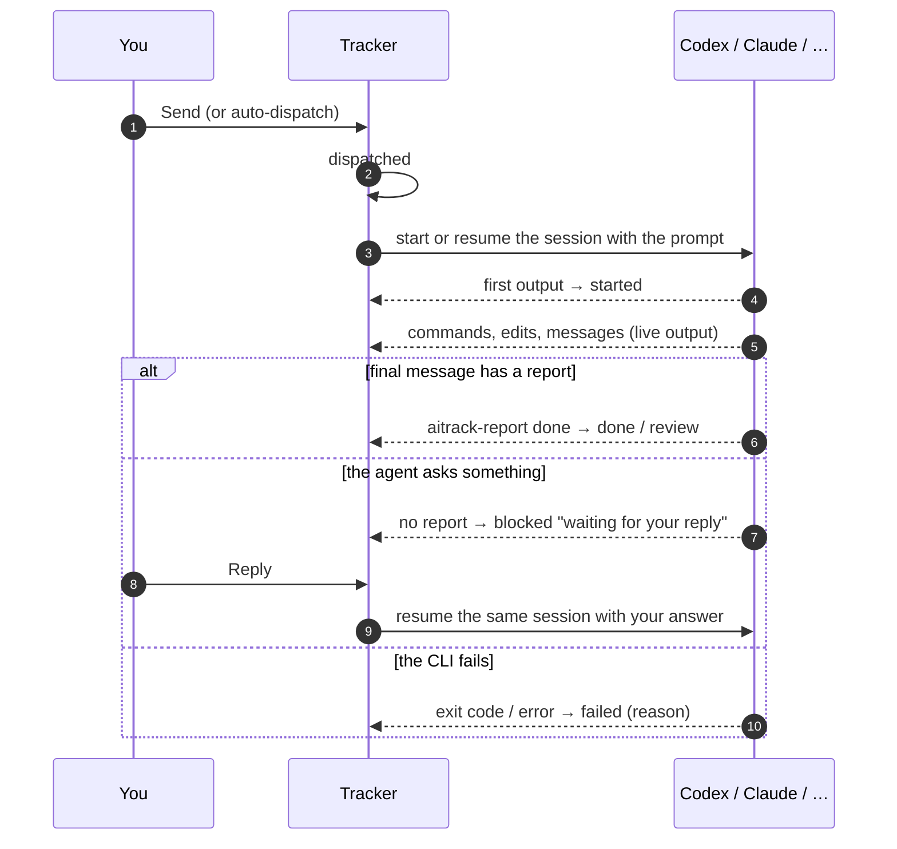

# Chats that run themselves

By default a chat is run **by hand**: you copy a task's prompt into the chat, and the chat reports back.
A chat can also be set up to **run by itself**. Then:

- **Send** starts the chat's session (or continues it) with the task prompt, in the chat's folder, and shows its output live.
- The task's status follows the run: *sent* → *in progress* when the agent starts → *done* when its final message carries a `done` report, or *waiting for your reply* when it stops to ask something.
- **Reply** in the task drawer continues the same session with your answer ("Approved, go ahead.", a correction, the missing value).
- **Auto-dispatch** sends each free chat its most urgent ready task as soon as it is free, within a limit of runs at once.

Sessions you keep opening by hand can update the board too, through [hooks](#hooks-for-sessions-you-open-yourself).

## Supported CLIs

The tracker runs the official command line tools, with **your own sign-in, plan and limits**. Install each one and sign in once in a terminal; the app finds it on `PATH` (including Homebrew, npm, nvm, Volta, Bun and `~/.local/bin`), or you can set its path.

| Runs with | Command the tracker runs | Prompt | Same conversation next time |
| --- | --- | --- | --- |
| **Codex CLI** | `codex exec --json -C <folder> -s workspace-write [resume <thread>] -` | standard input | thread id from the `thread.started` event |
| **Claude Code** | `claude -p --output-format stream-json --verbose --permission-mode auto (--session-id <uuid> \| --resume <id>)` | standard input | session id chosen by the tracker |
| **GitHub Copilot CLI** | `copilot -p <prompt> -s --no-color --no-ask-user --session-id <uuid> --allow-tool write` | argument | the same `--session-id` |
| **Gemini CLI** | `gemini -p <prompt> -o stream-json --skip-trust --approval-mode auto_edit (--session-id <uuid> \| --resume <uuid>)` | argument | session id chosen by the tracker |
| **Custom command** | anything, e.g. `cursor-agent -p --output-format text {{prompt}}` | `{{prompt}}`, or standard input | `{{sessionId}}` is a stable id per chat |

The custom command is plain text output: everything it prints is the final message, and an `aitrack-report` block in it is read like any other. It is how other agents (Cursor CLI, Aider, your own scripts) can be plugged in; the tracker does not test those tools.

### Access

| Access | Codex | Claude Code | Copilot | Gemini |
| --- | --- | --- | --- | --- |
| Read only | `-s read-only` | `--permission-mode plan` | no extra permissions | `--approval-mode plan` |
| **Edit files** (default) | `-s workspace-write` (+ optional network) | `--permission-mode auto` (or `acceptEdits`, see below) + the usual work commands | `--allow-tool write` | `--approval-mode auto_edit` |
| Full access | `--dangerously-bypass-approvals-and-sandbox` | `--permission-mode bypassPermissions` | `--allow-all-tools` | `--approval-mode yolo` |

A headless run cannot ask for permission, so anything outside its access is refused and the refusal shows up in the output and as a problem on the task.

**Claude Code's auto mode.** With **Edit files**, a Claude Code that lists `auto` among its permission modes (`claude --help`) runs with `--permission-mode auto`: a safety check in Claude Code approves routine steps — looking around folders outside the project, reading details of the computer, running tests — and blocks risky ones (deleting, pushing, sending data out) instead of the run refusing everything that is not on the allowed list. Edits inside the chat's working folder and the folders added with `--add-dir` are allowed with `Edit(//<folder>/**)` rules, as with `acceptEdits`. The first line of the run says which mode the session really runs in; when it is not `auto` (the account or an organization policy does not allow it) or the CLI refuses the mode, the run log says so and later runs use `acceptEdits` until the app restarts. *Let Claude Code approve routine steps itself* in the run settings turns it off; an older Claude Code is named there with `claude update`.

With **Edit files**, Claude Code also runs the usual work commands without asking (on by default, *Run the usual work commands without asking* in the run settings): reading and searching (`ls`, `cat`, `grep`, `find`, `sed`, `jq`…), details of this computer (`uname`, `sw_vers`, `sysctl`, `system_profiler`, `ps`, `df`, `docker ps`/`info`/`images`, `brew list`/`info`), folders and files (`mkdir`, `cp`, `mv`), local git (`status`, `diff`, `log`, `add`, `commit`, `switch`, `worktree`, `remote`, `config --get`…) and build and test (`node`, `npm`, `npx`, `pnpm`, `make`, `go`, `python`, `pytest`, `cargo`…). These run the project's own code, so keep the option on only for projects you trust. `git push`, `rm` and anything else still need a rule under **Extra allowed tools**. When the chat works outside the plan's repository, that repository is added with `--add-dir`, so the plan and its documents can be read; so are Claude Code's own notes for the working folder (`~/.claude/projects/<folder>/memory`, when it exists) and the folders under *Other folders it may use* (one full path per line; one that no longer exists is skipped).

**Refused steps.** All the steps a run refused go on one problem of the task, each with what it does in plain words and whether it only reads, makes changes or is risky (deleting, pushing, rewriting history, administrator rights, network tools). **Allow and continue** adds the Claude Code rules for the safe ones to that chat (and a folder outside its own that they looked at to *Other folders it may use*), then tells the chat to do them and go on where it stopped; **Allow the risky ones too** includes the rest. When the chat reports the task `done` or `review` anyway, its refused steps are only kept in the run log.

**Decisions.** Chats that run themselves are told to find missing facts with read-only commands, to take easy-to-undo choices themselves (noting them as a `warning`), to go on without a refused step, and to report `blocked` only for a real decision — asked in the project's language, with the options as `choices` on a `needs-you` problem. The task drawer and the floating window show the options as buttons; a click answers the chat in the person's language and closes the question. A chat that must wait for another task of the plan reports `blocked` with `"waitingFor": ["<task id>"]` instead of asking to be sent again: the task waits without a problem, the wait is written into the plan as a dependency, and the task goes back to the same chat when the other one is done ([details](agent-reporting.md#waiting-for-another-task-waitingfor)).

Copilot cannot run shell commands with **Edit files** unless you allow them, for example `shell(npm:*)`, `shell(git:*)`. Use **Full access** only in a disposable worktree or a container.

### Model and reasoning

The run settings offer the models each CLI knows: Codex's own catalog (`codex debug models`) with the reasoning levels of each model, Copilot's model list (`copilot help config`), and for Claude Code and Gemini the aliases that always follow the latest version (`opus`, `sonnet`, `haiku`, `fable`; `pro`, `flash`, `flash-lite`, `auto`). **Other** takes any model id. Reasoning effort is passed as `-c model_reasoning_effort=…` (Codex), `--effort` (Claude Code) and `--reasoning-effort` (Copilot); Gemini has none. **Default** leaves both to the CLI's own settings.

### Sessions

- **Continue the same session** (default): the first task starts a new session with the chat's session prompts, later tasks and replies continue it — like a chat you keep open. Its id is shown in the run settings; paste the id of an existing session to continue *that* conversation, or **Start fresh**.
- **New session for each task**: each task starts clean; replies continue the task's own session.
- The run settings show the command that continues the session in a terminal (`codex resume …`, `claude --resume …`), when you want to take over by hand.

One chat runs one thing at a time. When several chats edit code at once, give each its own **git worktree** as working folder.

### Where the chats work

A chat without a working folder of its own works in the project's **code folder**: `settings.repoPath` (relative to the project file) when the plan sets one, otherwise the git repository the project file is in. Change it under **Project settings → Code folder**. When a plan points at a folder that is not on this computer yet (a repository you have not created or cloned), the board says so and offers to **create the folder** as an empty git repository, choose another folder, or use the plan's own repository.

### What the agent is told

Before the task prompt, the tracker adds a short note: nobody watches the session live, end the final message with the `aitrack-report` block (no HTTP call or report file needed), and stop with status `blocked` and a question when a person must decide. With **Don't wait for plan approval**, the agent goes ahead without waiting for you to approve its plan, but still stops before anything involving payments, legal terms, identity checks, credentials, publishing or deleting data.

## How the status follows a run



**Stop** ends a run; the task stays with the chat as blocked, so you can reply or send it again. It is on the running line of the chat's lane, in the floating window, in the task drawer and its live output, and as **Stop all** next to automatic dispatch; the small buttons ask once more before they stop. Automatic dispatch gives a chat you stopped nothing new until you send it something (or switch automatic dispatch off and on); **Stop all** also switches automatic dispatch off. Runs that were going when the app quit are marked blocked on the next start.

## Auto-dispatch

The switch in the project header turns it on. Whenever something changes (a task is done, a chat is set up, a run ends), every free chat that runs by itself gets its most urgent **ready** task, until the **At once** limit is reached. It never re-sends a task that failed, and never sends to chats that are run by hand.

## The manager

For the night, or any time you are away, the **Manager** switch next to auto-dispatch hands the project to an AI CLI you choose (Claude Code, Codex, Gemini or Copilot, with a model). It turns auto-dispatch on and looks at the project a minute after things settle and every 10 minutes, at most as many times an hour as you set (6 by default), and only when something needs a decision: a task blocked on a question, a failed task, refused steps, proposed tasks or notes. It skips a situation it has already handled.

It runs read-only in the plan's folder and answers with actions that the app checks and carries out:

| Action | What the app does |
| --- | --- |
| reply | continues the chat's session with the answer (or sends the task again with it) |
| choose | picks one of the options the chat offered, and closes that problem |
| allow | allows refused steps that are not risky, for that Claude Code chat, and lets it go on |
| wait | parks the task until the tasks it waits for are done, as if the chat had reported `waitingFor` |
| resend | sends a failed task again, with a note |
| close | marks problems resolved or ignored |
| plan | folds proposed tasks and notes into the plan, the same way as **Fold into the current plan** |
| leave | leaves something for you, in one sentence |

It acts only on the tasks it was shown, one action per task; never approves payments, enters credentials, accepts legal terms, publishes, deletes data, pushes to a main branch or allows risky steps — those are left for you, and chats run by hand are never touched. With *Also continue tasks I stopped* off, a task you stopped stays stopped. Every action is written to the task's history (`Manager: …`, source `manager`), and the manager dialog lists its recent runs, what each did and what it left for you (kept in `~/.aitrack/manager/`). **Look now** runs it once. While chats run or a manager is on, the desktop app keeps the computer from going to sleep on its own; a laptop still sleeps when its lid is closed.

## Hooks for sessions you open yourself

Sessions you open by hand can report turn starts and ends. Add the snippet the run settings dialog shows (it has the right port), or:

**Claude Code** — `.claude/settings.json` in the repository, or `~/.claude/settings.json`:

```json
{
  "hooks": {
    "UserPromptSubmit": [{ "hooks": [{ "type": "command", "command": "curl -s -m 3 -X POST 'http://127.0.0.1:4317/api/hook?tool=claude' -H 'Content-Type: application/json' -H \"X-Aitrack-Chat: ${AITRACK_CHAT:-}\" -H \"X-Aitrack-Run: ${AITRACK_RUN:-}\" --data-binary @- >/dev/null 2>&1 || true" }] }],
    "Stop": [{ "hooks": [{ "type": "command", "command": "curl -s -m 3 -X POST 'http://127.0.0.1:4317/api/hook?tool=claude' -H 'Content-Type: application/json' -H \"X-Aitrack-Chat: ${AITRACK_CHAT:-}\" -H \"X-Aitrack-Run: ${AITRACK_RUN:-}\" --data-binary @- >/dev/null 2>&1 || true" }] }],
    "Notification": [{ "hooks": [{ "type": "command", "command": "curl -s -m 3 -X POST 'http://127.0.0.1:4317/api/hook?tool=claude' -H 'Content-Type: application/json' -H \"X-Aitrack-Chat: ${AITRACK_CHAT:-}\" -H \"X-Aitrack-Run: ${AITRACK_RUN:-}\" --data-binary @- >/dev/null 2>&1 || true" }] }]
  }
}
```

**Codex** — `~/.codex/config.toml`:

```toml
notify = ["sh", "-c", "curl -s -m 3 -X POST 'http://127.0.0.1:4317/api/hook?tool=codex' -H 'Content-Type: application/json' -H \"X-Aitrack-Chat: ${AITRACK_CHAT:-}\" -H \"X-Aitrack-Run: ${AITRACK_RUN:-}\" -d \"$1\" >/dev/null 2>&1 || true", "aitrack"]
```

`aitrack-report hook --tool claude` (stdin) and `aitrack-report hook --tool codex '<json>'` do the same without curl.

What the tracker does with them:

| Hook | Status change for the task the chat holds |
| --- | --- |
| Claude `UserPromptSubmit` | sent or blocked → in progress |
| Claude `Stop`, Codex `agent-turn-complete` | a report block in the last message is recorded; otherwise in progress → blocked "waiting for your reply" |
| Claude `Notification` | in progress → blocked "needs you: …" (for example a permission prompt) |

The hook finds the chat by, in order: `AITRACK_CHAT` (start the session as `AITRACK_CHAT=claude-a claude`), the session id saved for a chat, or the working folder plus the tool (`agent.tool` in the project file) when only one such chat holds a task. The session id of a matched session is saved, so **Send** later continues that very conversation. Runs started by the tracker carry `AITRACK_RUN` and are left to the runner. Codex `notify` only knows when turns end.

## Security

- Run settings are kept in `~/.aitrack/runners.json` (readable only by you), **never in the project file**: a shared or downloaded `.aitrack` file cannot make your computer run anything.
- Starting, replying, stopping and changing run settings need a **control token** (`~/.aitrack/control-token`) on top of the loopback-only and same-origin checks. The desktop app hands it to its own windows; `aitrack serve` prints a link with it (`http://127.0.0.1:4317/#token=…`) for a browser. Other users on the same computer and web pages cannot start agents.
- Hooks and reports only change task status; they cannot start programs.
- Agents run as you, in the folder you chose, with the access you chose. Output is shown as text and kept in `~/.aitrack/runs/<run>.log`.
- Using these CLIs is subject to each provider's terms and your plan's limits. Tasks that need a person (payments, identity checks, legal acceptance, computer use) should stay with a chat that is run by hand.

## API

| Endpoint | |
| --- | --- |
| `GET /api/providers` | installed CLIs, paths, versions, models and effort levels |
| `GET /api/projects/:key/runners` | run settings, recent runs, hook snippets |
| `POST /api/projects/:key/runners` 🔑 | `{autoDispatch, maxConcurrent}` |
| `POST /api/projects/:key/code-folder` 🔑 | create the project's code folder (`settings.repoPath`) as an empty git repository when it does not exist |
| `POST /api/projects/:key/runners/:chat` 🔑 | `{runner: {provider, workdir, access, session, sessionId, unattended, network, allowedTools, extraArgs, binary, command, model, effort}}` |
| `POST /api/projects/:key/tasks/:task/run` 🔑 | `{agent?}` — send the task |
| `POST /api/projects/:key/agents/:chat/reply` 🔑 | `{text, task?}` — continue the chat's session |
| `POST /api/runs/:id/stop` 🔑 | stop a run |
| `POST /api/projects/:key/runs/stop` 🔑 | stop every run of the project and switch its automatic dispatch off |
| `GET /api/runs/:id/log?after=n` | output lines |
| `POST /api/hook?tool=claude\|codex\|…` | hook payloads |
| `POST /api/authoring/generate` 🔑 | `{provider: claude\|codex\|gemini\|copilot, cwd, input, model?}` — write a project plan with that CLI, read-only in `cwd` |
| `GET /api/authoring/generate/:id` · `POST …/:id/stop` 🔑 | progress and answer of a plan being written; stop it |
| `POST /api/projects/:key/manager` 🔑 | `{enabled, provider, model, effort, binary, maxRunsPerHour, resumeStopped}` — the manager; its state and log come with `GET …/runners` as `manager` |
| `POST /api/projects/:key/manager/run` 🔑 | let the manager look once, now (409 when nothing waits for a decision) |
| `POST /api/projects/:key/proposals/integrate` 🔑 | `{provider, model?}` — fold proposed tasks and notes into the plan with that CLI; see [reporting](agent-reporting.md#work-left-for-later-followups) |

🔑 needs the `X-Aitrack-Token` header. Live updates arrive on `GET /api/stream` as `run`, `runlog` and `runners` events.

Platforms: tested on macOS and Linux. On Windows, set the program path to the CLI's `.exe`; `.cmd` launchers are not supported.
