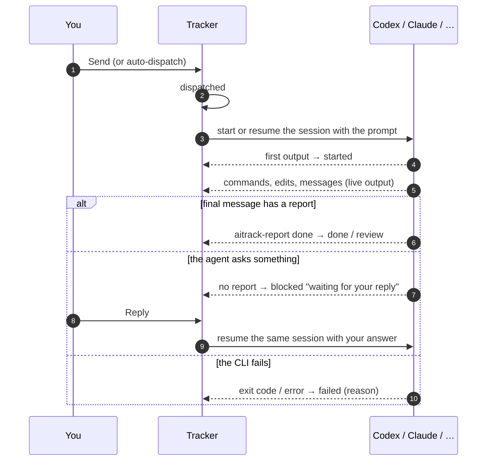

# Chats that run themselves

By default a chat is run **by hand**: you copy a task's prompt into the chat, and the chat reports back.
A chat can also be set up to **run by itself**. Then:

- **Send** starts the chat's session (or continues it) with the task prompt, in the chat's folder, and shows its output live.
- The task's status follows the run: *sent* → *in progress* when the agent starts → *done* when its final message carries a `done` report, or *waiting for your reply* when it stops to ask something.
- **Reply** in the task drawer continues the same session with your answer ("Approved, go ahead.", a correction, the missing value).
- **Auto-dispatch** sends each free chat its most urgent ready task as soon as it is free, within a limit of runs at once.

Sessions you keep opening by hand can update the board too, through [hooks](#hooks-for-sessions-you-open-yourself).

## Supported CLIs

The tracker runs the official command line tools, with **your own sign-in, plan and limits**. Install each one and sign in once in a terminal; the app finds it on `PATH` (including Homebrew, npm, nvm, Volta, Bun and `~/.local/bin`), or you can set its path.

| Runs with | Command the tracker runs | Prompt | Same conversation next time |
| --- | --- | --- | --- |
| **Codex CLI** | `codex exec --json -C <folder> -s workspace-write [resume <thread>] -` | standard input | thread id from the `thread.started` event |
| **Claude Code** | `claude -p --output-format stream-json --verbose --permission-mode auto (--session-id <uuid> \| --resume <id>)` | standard input | session id chosen by the tracker |
| **GitHub Copilot CLI** | `copilot -p <prompt> -s --no-color --no-ask-user --session-id <uuid> --allow-tool write` | argument | the same `--session-id` |
| **Antigravity CLI** | `agy -p <prompt> --output-format stream-json --mode auto [--conversation <id>] [--add-dir <folder>]… [--model <slug>] [--effort <level>]` | argument | `conversation_id` from the `init` event |
| **Gemini CLI** (chats set to it before) | `gemini -p <prompt> -o stream-json --skip-trust --approval-mode auto_edit (--session-id <uuid> \| --resume <uuid>)` | argument | session id chosen by the tracker |
| **Cursor CLI** | `cursor-agent -p --output-format stream-json --trust --workspace <folder> --force --sandbox enabled [--resume=<id>] <prompt>` | argument | `session_id` from the first line |
| **DeepSeek CLI** | `dsh --profile headless [--patch <model overlay>] --json --permission-mode workspace-write --approval-policy never [--session-id <id>] [--add-dir <folder>]… -` | standard input | `sessionId` from the opening `session` event |
| **Custom command** | anything, e.g. `aider --message {{prompt}}` | `{{prompt}}`, or standard input | `{{sessionId}}` is a stable id per chat |

Cursor's CLI is found as `cursor-agent`, or as `agent` in newer installs when its help says it is Cursor's. Install it with `curl https://cursor.com/install -fsS | bash` and sign in once with `cursor-agent login` (or set `CURSOR_API_KEY`).

DeepSeek's CLI is DeepSeek Harness (`dsh`, npm `@deepseek-ai/dsh`, Node.js 24.9 or newer; a `dsh` whose help does not name DeepSeek is not taken for it). The tracker runs its one-shot *headless* profile: one task per run, read from standard input, events as JSON lines, and the next message continues the same Session with `--session-id` from the same folder. It takes its key from the environment or `~/.dsh/.env` (`DEEPSEEK_API_KEY=…`); keys saved in DeepSeek's web app are not used by this mode, and the key never goes through the tracker. Its model is a setting rather than a flag: when you pick a model or an effort (off, low, high, max) in the run settings, the tracker writes a small overlay with only those two values to the temp folder (`aitrack-deepseek/<model>-<effort>.yml`) and passes it with `--patch`; an effort without a model uses DeepSeek Flash. Nobody can answer its approval prompts in this mode, so `--approval-policy never` refuses what the access level does not allow and the refusal becomes a problem on the task. With *Edit files*, the folders in *Other folders it may use* and the plan's repository are added with `--add-dir`, and so is a worktree's shared `.git` folder, so the chat can commit (that also lets it change the repository's hooks and settings: use worktrees you trust). Its sandbox may keep commands off the network.

Antigravity CLI (`agy`, Google Antigravity's command line tool, which follows Gemini CLI) replaces Gemini CLI in the lists; a chat already set to Gemini CLI keeps it. Install it with `curl -fsSL https://antigravity.google/cli/install.sh | bash` (it goes to `~/.local/bin`) and sign in once by running `agy` in a terminal. The tracker runs it in print mode, one prompt per run, with events as JSON lines (`init`, `step_update`, `result`); the next message continues the same conversation with `--conversation`. Its models depend on your plan — Gemini, and on paid plans also Claude and GPT models — so the run settings list what `agy models` returns for the signed-in account, grouped by family, and say so; when it lists nothing (not signed in yet), sign in and refresh. Effort (`low` to `max`, depending on the model) goes with `--effort`. Nobody can approve a step in print mode: with *Edit files* it runs in `--mode auto`, where workspace edits and safe commands run and risky ones are refused (soft-denied) and become a problem on the task; *Read only* is `--mode plan`, *Full access* `--dangerously-skip-permissions`. Other folders go with `--add-dir`. A run out of its AI credits waits like any usage limit.

The custom command is plain text output: everything it prints is the final message, and an `aitrack-report` block in it is read like any other. It is how other agents (Aider, your own scripts) can be plugged in; the tracker does not test those tools.

### Access

| Access | Codex | Claude Code | Copilot | Antigravity | Cursor | DeepSeek |
| --- | --- | --- | --- | --- | --- | --- |
| Read only | `-s read-only` | `--permission-mode plan` | no extra permissions | `--mode plan` | `--mode ask` | `--permission-mode read-only` |
| **Edit files** (default) | `-s workspace-write` (+ optional network) | `--permission-mode auto` (or `acceptEdits`, see below) + the usual work commands | `--allow-tool write` | `--mode auto` | `--force --sandbox enabled` (commands in Cursor's sandbox) | `--permission-mode workspace-write` (its sandbox) |
| Full access | `--dangerously-bypass-approvals-and-sandbox` | `--permission-mode bypassPermissions` | `--allow-all-tools` | `--dangerously-skip-permissions` | `--force --sandbox disabled` | `--permission-mode danger-full-access` |

Gemini CLI, for chats set to it before: `--approval-mode plan`, `auto_edit`, `yolo`.

A headless run cannot ask for permission, so anything outside its access is refused and the refusal shows up in the output and as a problem on the task.

**Claude Code's auto mode.** With **Edit files**, a Claude Code that lists `auto` among its permission modes (`claude --help`) runs with `--permission-mode auto`: a safety check in Claude Code approves routine steps — looking around folders outside the project, reading details of the computer, running tests — and blocks risky ones (deleting, pushing, sending data out) instead of the run refusing everything that is not on the allowed list. Edits inside the chat's working folder and the folders added with `--add-dir` are allowed with `Edit(//<folder>/**)` rules, as with `acceptEdits`. The first line of the run says which mode the session really runs in; when it is not `auto` (the account or an organization policy does not allow it) or the CLI refuses the mode, the run log says so and later runs use `acceptEdits` until the app restarts. *Let Claude Code approve routine steps itself* in the run settings turns it off; an older Claude Code is named there with `claude update`.

With **Edit files**, Claude Code also runs the usual work commands without asking (on by default, *Run the usual work commands without asking* in the run settings): reading and searching (`ls`, `cat`, `grep`, `find`, `sed`, `jq`…), details of this computer (`uname`, `sw_vers`, `sysctl`, `system_profiler`, `ps`, `df`, `docker ps`/`info`/`images`, `brew list`/`info`), folders and files (`mkdir`, `cp`, `mv`), local git (`status`, `diff`, `log`, `add`, `commit`, `switch`, `worktree`, `remote`, `config --get`…) and build and test (`node`, `npm`, `npx`, `pnpm`, `make`, `go`, `python`, `pytest`, `cargo`…). These run the project's own code, so keep the option on only for projects you trust. `git push`, `rm` and anything else still need a rule under **Extra allowed tools**. When the chat works outside the plan's repository, that repository is added with `--add-dir`, so the plan and its documents can be read; so are Claude Code's own notes for the working folder (`~/.claude/projects/<folder>/memory`, when it exists) and the folders under *Other folders it may use* (one full path per line; one that no longer exists is skipped).

**Refused steps.** All the steps a run refused go on one problem of the task, each with what it does in plain words and whether it only reads, makes changes or is risky (deleting, pushing, rewriting history, administrator rights, network tools). **Allow and continue** adds the Claude Code rules for the safe ones to that chat (and a folder outside its own that they looked at to *Other folders it may use*), then tells the chat to do them and go on where it stopped; **Allow the risky ones too** includes the rest. When the chat reports the task `done` or `review` anyway, its refused steps are only kept in the run log.

**Permissions a chat asks for.** A chat of any CLI that needs a permission it does not have names it on a problem (`"permission": {"kind": "command" | "network" | "folder", "value": …}`, see [reporting](agent-reporting.md)). The task drawer shows what it asks for and **Allow from now on and continue**, which writes it into that chat's run settings for good and tells the chat to go on in the same conversation, the way its CLI takes it: a command becomes an *Extra allowed tools* entry for Claude Code (`Bash(npm ci:*)`) and Copilot (`shell(npm ci:*)`); network access turns on Codex's *Network access* (Claude Code, Copilot and Gemini do not block it, so the chat is just told to go on); a folder goes to *Other folders it may use* for Claude Code, Codex, DeepSeek, Copilot and Gemini. What a CLI cannot allow on its own — a single command for Codex, Gemini, Cursor or DeepSeek, say — needs full access: the drawer offers **Give this chat full access and continue** behind a warning, and the floating window leaves that to the main window. When the chat did not name the permission but its problem shows it — a Codex or DeepSeek chat whose sandbox kept a command off the network (`ENOTFOUND`, `EAI_AGAIN`, listening on `127.0.0.1` refused with `EPERM`), or stopped it (`Operation not permitted`, a read-only file system, a folder outside it) — the drawer offers the same button, marked *read from the problem*; allowing it settles every card the same permission covers. When network is already on and the sandbox still stops the step (a browser that cannot start inside it, say), only full access is left. The manager grants these only with *Full authority*; otherwise it leaves them for you.

**Decisions.** Chats that run themselves are told to find missing facts with read-only commands, to take easy-to-undo choices themselves (noting them as a `warning`), to go on without a refused step, and to report `blocked` only for a real decision — asked in the project's language, with the options as `choices` on a `needs-you` problem. The task drawer and the floating window show the options as buttons; a click answers the chat in the person's language and closes the question. A chat that must wait for another task of the plan reports `blocked` with `"waitingFor": ["<task id>"]` instead of asking to be sent again: the task waits without a problem, the wait is written into the plan as a dependency, and the task goes back to the same chat when the other one is done ([details](agent-reporting.md#waiting-for-another-task-waitingfor)).

Copilot cannot run shell commands with **Edit files** unless you allow them, for example `shell(npm:*)`, `shell(git:*)`. Use **Full access** only in a disposable worktree or a container.

### Model and reasoning

The run settings offer the models each CLI knows: Codex's own catalog (`codex debug models`) with the reasoning levels of each model, Copilot's model list (`copilot help config`), and for Claude Code and Gemini the aliases that always follow the latest version (`opus`, `sonnet`, `haiku`, `fable`; `pro`, `flash`, `flash-lite`, `auto`). **Other** takes any model id. Reasoning effort is passed as `-c model_reasoning_effort=…` (Codex), `--effort` (Claude Code) and `--reasoning-effort` (Copilot); Gemini has none. **Default** leaves both to the CLI's own settings.

### Sessions

- **Continue the same session** (default): the first task starts a new session with the chat's session prompts, later tasks and replies continue it — like a chat you keep open. When a session prompt changes (a new rule in the shared protocol, say), the next task a conversation gets starts with the current version and a note that it changed; the tracker remembers which version each conversation read (and gives it once to conversations it has no record of). Its id is shown in the run settings; paste the id of an existing session to continue *that* conversation, or **Start fresh**.
- **New session for each task**: each task starts clean; replies continue the task's own session.
- The run settings show the command that continues the session in a terminal (`codex resume …`, `claude --resume …`), when you want to take over by hand.

One chat runs one thing at a time. When several chats edit code at once, give each its own **git worktree** as working folder.

### Where the chats work

A chat without a working folder of its own works in the project's **code folder**: `settings.repoPath` (relative to the project file) when the plan sets one, otherwise the git repository the project file is in. Change it under **Project settings → Code folder**. When a plan points at a folder that is not on this computer yet (a repository you have not created or cloned), the board says so and offers to **create the folder** as an empty git repository, choose another folder, or use the plan's own repository.

### What the agent is told

Before the task prompt, the tracker adds a short note: nobody watches the session live, end the final message with the `aitrack-report` block (no HTTP call or report file needed), and stop with status `blocked` and a question when a person must decide. With **Don't wait for plan approval**, the agent goes ahead without waiting for you to approve its plan, but still stops before anything involving payments, legal terms, identity checks, credentials, publishing or deleting data.

## How the status follows a run



**Other folders.** Besides its working folder, a chat may use other folders: another repository of the project, shared docs, assets. *Other folders it may use* (each chat) and *Folders for every chat of this project* (all chats of the project, on top of their own) sit under the working folder in the run settings; **Add folder** opens the folder dialog in the desktop app, or a path can be typed. Claude Code, Codex, DeepSeek and Copilot get them as `--add-dir`, Gemini as `--include-directories`; Codex and DeepSeek may write there within their sandbox. Cursor and custom commands work only in their working folder. A folder that no longer exists is skipped, so it does not stop the CLI. The project's list is kept with its run settings on this computer (`POST /api/projects/:key/runners` with `{extraDirs}`, one absolute path per line).

**Saving mode** (the *Saving* switch next to automatic dispatch, off by default) cuts the tokens long conversations cost. A CLI reads the whole conversation again at every step, so a chat that keeps one conversation for all its tasks pays for every earlier task on every step of the next one (hundreds of thousands of tokens each time, once it has done a few). In saving mode each task gets a conversation of its own: the first run of a task starts a new one (with the session prompt), and replies, resumes and sending it again go on in that task's conversation. What chats checked about the environment and the project — `facts` in their reports, such as "pgvector 0.8 is enabled on the dev database" — is kept (the newest 40) and given to the next tasks as *already checked*, so they do not check it again; **Facts** next to the switch lists them with who checked what and when, and removes what is wrong or out of date. The tracker keeps each chat's conversation per task, and what Codex and Claude Code count for a whole conversation, in `~/.aitrack/runners.json`.

Run details show what each run used. Codex counts tokens for its whole conversation and Claude Code its cost; a run that continues a conversation shows only what it added.

A conversation belongs to the CLI that had it: when a chat is moved to another CLI, the tracker forgets its conversations and the next task starts a new one. When a CLI cannot find the conversation it was asked to continue (it was deleted, or the id is another CLI's) and the run did nothing yet, the run starts again once in a new conversation, with the task and the person's words, instead of failing, and the task's history says so. The tracker records which CLI each saved conversation belongs to (`sessionProvider`; for older ones it reads the id's shape: Codex threads are UUID v7): a chat whose saved conversation is another CLI's shows a red **!** on its badge, and its run settings warn and offer **Reset session id**. If a task still fails because its conversation is gone, its problem card offers **Reset the session and send again**.

**Stop** ends a run; the task stays with the chat as blocked, so you can reply or send it again. It is on the running line of the chat's lane, in the floating window, in the task drawer and its live output, and as **Stop all** next to automatic dispatch; the small buttons ask once more before they stop. Automatic dispatch gives a chat you stopped nothing new until you send it something (or switch automatic dispatch off and on); **Stop all** also switches automatic dispatch off. Runs that were going when the app quit are marked blocked on the next start.

## Stopping, and going on

**Stop** ends a run; the task stays with its chat, blocked, and automatic dispatch gives that chat nothing new. **Reply** continues the same conversation. **Send** again continues it too (with *same session*), and the prompt tells the chat it already worked on the task and was interrupted, so it goes on where it stopped instead of starting over. When no conversation was started (stopped before the CLI answered, or *a new session per task*), the chat is told to check what is already done in the working folder (git status, git diff) first. The same applies to a task sent again after it failed, or after the app was closed while it ran.

## Usage limits

When a CLI says the plan's usage limit is used up (Claude Code's 5-hour or weekly limit, Codex's usage limit, Gemini's quota, a rate limit), the run is not counted as failed. The task is parked with the time it goes on (`Usage limit: <CLI> · until <time>`), shown as waiting, and raises no problem; automatic dispatch sends nothing to chats on that CLI, and the manager leaves them alone. The tracker does not poll the CLI to see whether the limit is over; it works out when it resets, once:

1. from the CLI's message: an epoch, "try again in 2 hours 13 minutes", "resets 3pm (Europe/Istanbul)", "resets Mon 9am", `resets_in_seconds`;
2. for Codex, from its own session records (`~/.codex/sessions`), which keep the reset time of each window;
3. from the plan: 5 hours after the first run of the CLI's current window (Claude Code, Codex), midnight Pacific time for Gemini's daily quota, the 1st of the month for Copilot's premium requests, the date in the message for Cursor's billing cycle ("resets on Dec 1"); a weekly limit or a Cursor cycle without a date is looked at again a day later;
4. a bare rate limit (429) waits 2 minutes; if it comes back at once, it is treated as the plan's limit. DeepSeek's API has no plan windows: its limits wait 2 minutes, then 15 if they come back at once. An empty DeepSeek balance is an error, not a limit.

At that time each parked task goes on with its chat — the same conversation when there is one — and automatic dispatch resumes. Limits and windows survive a restart of the app (`~/.aitrack/limits.json`). While a chat waits for its limit, the desktop app keeps the computer from going to sleep on its own; the clock is read again every minute, so after a sleep (a closed lid) the chats go on as soon as the computer wakes. The header shows *⏳ Claude Code limit · 15:00* while one lasts, with where the time comes from; clicking it goes on now (when you know the limit is over). A manager whose own CLI hits its limit looks again when it resets. `POST /api/projects/:key/limits/retry` 🔑 with `{agent}` does the same as the click.

## Auto-dispatch

The switch in the project header turns it on. Whenever something changes (a task is done, a chat is set up, a run ends), every free chat that runs by itself gets its most urgent **ready** task, until the **At once** limit is reached. It never re-sends a task that failed, and never sends to chats that are run by hand.

## The manager

For the night, or any time you are away, the **Manager** switch next to auto-dispatch hands the project to an AI CLI you choose (Claude Code, Codex, Gemini or Copilot, with a model). It turns auto-dispatch on and does not poll: it is woken by what happens in the project — a report, a run that ended, a problem closed — and calls its CLI only when something new needs a decision: a chat that asks a question or waits for approval, a failed task, refused steps, proposed tasks or notes. It waits 15 seconds first, so a report and the end of its run, or several chats that stop together, are handled in one go, and it skips a situation it has already handled. Otherwise it wakes up only to try again after its own run failed (after 2, 5, 15, then every 30 minutes). What it left for you is not shown to it again until that task changes. A fixed guard of 30 runs an hour stops a loop, should every run cause another; it is not a setting.

It runs read-only in the plan's folder and answers with actions that the app checks and carries out:

| Action | What the app does |
| --- | --- |
| reply | continues the chat's session with the answer (or sends the task again with it) |
| choose | picks one of the options the chat offered, and closes that problem |
| allow | allows refused steps that are not risky, for that Claude Code chat, and lets it go on |
| wait | parks the task until the tasks it waits for are done, as if the chat had reported `waitingFor` |
| resend | sends a failed task again, with a note |
| close | marks problems resolved or ignored |
| approve | with *Also approve finished work* on: approves a task in review whose report shows it is done as asked (summary, how it was verified, the task's acceptance); a task with open problems is never approved and is left for you. With *Full automation* it reviews the work itself and approves work whose remaining gaps do not stop others, with what you may want to look at (`check`) |
| revise | with *Full automation* on: sends a task in review back to its chat with what to fix (at most twice per task; then it is left for you) |
| merge | with *Merge green PRs into main* on: has a reviewed task's own chat merge that task's PRs (green checks only, merge commit, no branch deleted, no force-push), once per task; it approves the task after the chat reports again. With *Full authority* also a waiting task's chat, for the PRs of other tasks it needs in main (named in `note`) |
| grant | with *Full authority* on: gives a task's chat, for good, the permission one of its problems asks for or shows (the same change as the person's **Allow from now on and continue**, full access included), closes the problems it settles and lets the chat go on |
| assign | with *Full authority* on: gives any task of the plan that waits, is ready, blocked or failed to another chat (`to`, `note`); a task its chat holds is released and starts over with the new chat |
| drop | with *Full authority* on: takes a task no chat has started out of the plan when another task covers it or it is a duplicate (`note` says which); at most ten per look |
| tune | with *Full authority* on: sets a chat's model and/or effort for its next runs (`chat`, `model`, `effort`, `note`), only to a model its CLI lists here (for Antigravity, Codex and Cursor: the ones the signed-in account may use) and an effort that CLI or model takes; a new model that does not take the chat's effort runs at its default. One change per chat per look; never the CLI, access or permissions |
| next | with *Full authority* on: puts a task no chat has started first (`note` says why); automatic dispatch gives it to a free chat that can take it before any other ready task. Several in one look keep their order, before what was first already |
| depend | with *Full authority* on: makes a task no chat has started wait for other tasks (`on`, `note`), as a dependency in the plan; one that would make a cycle is refused. At most fifteen per look |
| plan | folds proposed tasks and notes into the plan, the same way as **Fold into the current plan** |
| leave | leaves something for you, in one sentence |

Besides the board, each look shows it every chat's CLI, model, effort and access and what it is running, and — with *Full authority*, or when you write to it — the models and efforts each of those CLIs offers here; the plan marks what goes first and how often a task failed or was sent back.

It acts only on the tasks it was shown, one action per task; never approves payments, enters credentials, accepts legal terms, publishes, deletes data, pushes to a main branch or allows risky steps — those are left for you, and chats run by hand are never touched. With *Also continue tasks I stopped* off, a task you stopped stays stopped. In a project where finished tasks wait for your approval (`requireApproval`), they wait for you unless *Also approve finished work* is on (off by default).

**Full automation** (off by default) has the manager review finished work in your place instead of only reading the report. With Claude Code as the manager's CLI it may run read-only commands for that — `git status/log/diff/show` in the chat's folder, `gh pr view/diff/checks`, `gh run view/list` — and read the chat's folder; other CLIs judge from the report and say so. Work that does not do what the task asks, or whose checks fail, goes back to its chat with what to fix (at most twice; then it is left for you). Work whose remaining gaps do not stop other work — a test skipped or not in CI yet, a check only a person can do such as comparing with a design or trying a real device, a small deviation the chat explains — is approved: the manager closes those problems, adds real remaining work to the plan and writes what you may want to look at. Everything it approved is listed under **Approved by the manager** in its dialog and in the eye, newest first, the ones you have not looked at marked new, each with why and what to look at; **Looked at** (or **Mark all as looked at**) clears the mark (`~/.aitrack/manager/`, `POST /api/projects/:key/manager/approvals/seen` with `{tasks?}`). If something is off, reopen the task.

The manager has no conversation of its own: each look starts from the project as it is now. So it also gets its memory from the tracker: what it did in its last fifteen looks (up to forty actions, with their reasons, refused ones too — a task it took out of the plan is only there) and its last conversations with the person, from its log in `~/.aitrack/manager/`. What must hold longer than that window it keeps as standing notes, at most 20, shown under **What it keeps in mind** in its dialog: the person's decisions and rules for the project (who does which kind of work, what not to do) and facts it would otherwise look up again. It adds them and drops the ones that no longer hold in its answer (`"remember"`, `"forget"`); you can add a rule there yourself or remove a note, and your own notes stay until you change them (it drops one of yours only when you ask it to in a message). The memory does not grow over time: a fixed window of looks and at most 20 notes. Changing its CLI or model keeps this memory.

**Full authority** (off by default) hands the manager your decisions instead of listing them for you: it grants the permissions chats ask for or that their problems show (network in a sandbox, another folder, a command — and full access when the chat's CLI has nothing finer), moves tasks to other chats, takes duplicate tasks nobody started out of the plan, has chats merge the green PRs a task needs (also other tasks' PRs), sets each chat's model and effort, decides which tasks go first and which wait for others, continues stopped work, and handles what it left for you before (that list comes back to it when the setting changes). It includes the options above. Payments, signing in or creating accounts, legal terms, deleting data or branches, publishing and pushing to main still stay with you; every grant, move, removal and change of a chat's model or effort is written to the task's history or the manager's log.

**Goes first.** Tasks put first (by the manager's `next`, in its dialog under **Goes first**) are given out by automatic dispatch before the board's own order (tasks going back to their chat, then the longest chain of work). A task leaves the list when it starts; take one off or clear the list there (`POST /api/projects/:key/first-up` with `{tasks}`, an empty list clears it). Kept on this computer with the run settings.

**⚡ Optimize tokens & speed** in the manager dialog turns *Saving* on and has the manager go over the whole project once, even when it is off: lower effort (or a faster model) for mechanical work such as CI and PR fixes, merging and small edits, high effort kept for design, architecture and hard debugging; tasks that unblock others first; tasks that touch a failing gate wait for the task that fixes it; tasks that failed or were sent back twice split or given to a chat that can do them, duplicates dropped; and what it decided kept as standing notes. With *Full authority* it makes the changes; without it, it changes nothing and lists them in its answer. It costs one look of the manager (`POST /api/projects/:key/manager/optimize`).

**Merge green PRs into main** (off by default, needs approving on) lets the manager have a reviewed task's own chat merge that task's PRs into main: only when CI and the required checks are green, with a merge commit, starting with the lowest of stacked PRs, without deleting branches, force-pushing or pushing to main, and only that task's PRs. It asks each task's chat once; the chat reports again and the manager approves it then. A Claude Code chat gets the `gh pr merge/edit/view/checks` and `gh run` commands for that one reply only (not saved in its settings); other CLIs merge with their own permissions. The merge runs with the GitHub access of this computer. Otherwise merging into main stays with you, like pushing. Every action is written to the task's history (`Manager: …`, source `manager`), and the manager dialog lists its recent runs, what each did and what it left for you (kept in `~/.aitrack/manager/`). **Look now** runs it once. While it is on, a small eye floats above all apps (in the desktop app; on the board in a browser) and can be dragged anywhere; clicking it shows the models at work, the project's progress, errors and the latest news; when managers run several projects, tabs switch between them (a red **!** marks one with problems, and a problem anywhere turns the eye red) and the models at work of every project are listed; clicking a line opens it in place to read it whole, and its **Show in the app** button opens the task. **Waiting for you** at the top lists what the manager left for you (one line per task, its newest message) and the permissions chats need that the manager may not give (all of them unless it has *Full authority*), and a number next to the eye counts them, also while it is closed; opening a line shows the task's card, as in the floating window, to allow a permission, pick an option, allow refused steps or answer the chat right there (full access is still given from the task's page in the app), and **Looked at** hides a line until it says something new. The three dots in the projection's header change how the eye looks: the green hologram, the Eye of Ra in black liquid glass (white on black; its iris turns red when something is wrong), or white liquid glass; the choice is kept on this computer. At the bottom, **Write to the manager** sends it a message ("approve CLC-02", "tell Claude B to go on"): it looks at once, even when it is off, acts on the message with the actions above (a message may ask it to approve a finished task) and answers there; NEVER still holds (hover it to hide it, the eye button next to the Manager switch brings it back). While chats run or a manager is on, the desktop app keeps the computer from going to sleep on its own; a laptop still sleeps when its lid is closed.

## Hooks for sessions you open yourself

Sessions you open by hand can report turn starts and ends. Add the snippet the run settings dialog shows (it has the right port), or:

**Claude Code** — `.claude/settings.json` in the repository, or `~/.claude/settings.json`:

```json
{
  "hooks": {
    "UserPromptSubmit": [{ "hooks": [{ "type": "command", "command": "curl -s -m 3 -X POST 'http://127.0.0.1:4317/api/hook?tool=claude' -H 'Content-Type: application/json' -H \"X-Aitrack-Chat: ${AITRACK_CHAT:-}\" -H \"X-Aitrack-Run: ${AITRACK_RUN:-}\" --data-binary @- >/dev/null 2>&1 || true" }] }],
    "Stop": [{ "hooks": [{ "type": "command", "command": "curl -s -m 3 -X POST 'http://127.0.0.1:4317/api/hook?tool=claude' -H 'Content-Type: application/json' -H \"X-Aitrack-Chat: ${AITRACK_CHAT:-}\" -H \"X-Aitrack-Run: ${AITRACK_RUN:-}\" --data-binary @- >/dev/null 2>&1 || true" }] }],
    "Notification": [{ "hooks": [{ "type": "command", "command": "curl -s -m 3 -X POST 'http://127.0.0.1:4317/api/hook?tool=claude' -H 'Content-Type: application/json' -H \"X-Aitrack-Chat: ${AITRACK_CHAT:-}\" -H \"X-Aitrack-Run: ${AITRACK_RUN:-}\" --data-binary @- >/dev/null 2>&1 || true" }] }]
  }
}
```

**Codex** — `~/.codex/config.toml`:

```toml
notify = ["sh", "-c", "curl -s -m 3 -X POST 'http://127.0.0.1:4317/api/hook?tool=codex' -H 'Content-Type: application/json' -H \"X-Aitrack-Chat: ${AITRACK_CHAT:-}\" -H \"X-Aitrack-Run: ${AITRACK_RUN:-}\" -d \"$1\" >/dev/null 2>&1 || true", "aitrack"]
```

`aitrack-report hook --tool claude` (stdin) and `aitrack-report hook --tool codex '<json>'` do the same without curl.

What the tracker does with them:

| Hook | Status change for the task the chat holds |
| --- | --- |
| Claude `UserPromptSubmit` | sent or blocked → in progress |
| Claude `Stop`, Codex `agent-turn-complete` | a report block in the last message is recorded; otherwise in progress → blocked "waiting for your reply" |
| Claude `Notification` | in progress → blocked "needs you: …" (for example a permission prompt) |

The hook finds the chat by, in order: `AITRACK_CHAT` (start the session as `AITRACK_CHAT=claude-a claude`), the session id saved for a chat, or the working folder plus the tool (`agent.tool` in the project file) when only one such chat holds a task. The session id of a matched session is saved, so **Send** later continues that very conversation. Runs started by the tracker carry `AITRACK_RUN` and are left to the runner. Codex `notify` only knows when turns end.

## Security

- Run settings are kept in `~/.aitrack/runners.json` (readable only by you), **never in the project file**: a shared or downloaded `.aitrack` file cannot make your computer run anything.
- Starting, replying, stopping and changing run settings need a **control token** (`~/.aitrack/control-token`) on top of the loopback-only and same-origin checks. The desktop app hands it to its own windows; `aitrack serve` prints a link with it (`http://127.0.0.1:4317/#token=…`) for a browser. Other users on the same computer and web pages cannot start agents.
- Hooks and reports only change task status; they cannot start programs.
- Agents run as you, in the folder you chose, with the access you chose. Output is shown as text and kept in `~/.aitrack/runs/<run>.log`.
- Using these CLIs is subject to each provider's terms and your plan's limits. Tasks that need a person (payments, identity checks, legal acceptance, computer use) should stay with a chat that is run by hand.

## API

| Endpoint | |
| --- | --- |
| `GET /api/providers` | installed CLIs, paths, versions, models and effort levels |
| `GET /api/projects/:key/runners` | run settings, recent runs, hook snippets |
| `POST /api/projects/:key/runners` 🔑 | `{autoDispatch, maxConcurrent, saving, extraDirs}` |
| `POST /api/projects/:key/facts/remove` 🔑 | `{texts: [...]}` or `{all: true}` — what chats checked (`facts`, with `GET …/runners`) |
| `POST /api/projects/:key/code-folder` 🔑 | create the project's code folder (`settings.repoPath`) as an empty git repository when it does not exist |
| `POST /api/projects/:key/runners/:chat` 🔑 | `{runner: {provider, workdir, access, session, sessionId, unattended, network, allowedTools, extraArgs, binary, command, model, effort}}` |
| `POST /api/projects/:key/tasks/:task/run` 🔑 | `{agent?}` — send the task |
| `POST /api/projects/:key/agents/:chat/reply` 🔑 | `{text, task?}` — continue the chat's session |
| `POST /api/runs/:id/stop` 🔑 | stop a run |
| `POST /api/projects/:key/runs/stop` 🔑 | stop every run of the project and switch its automatic dispatch off |
| `GET /api/runs/:id/log?after=n` | output lines |
| `POST /api/hook?tool=claude\|codex\|…` | hook payloads |
| `POST /api/authoring/generate` 🔑 | `{provider: claude\|codex\|gemini\|copilot, cwd, input, model?}` — write a project plan with that CLI, read-only in `cwd` |
| `GET /api/authoring/generate/:id` · `POST …/:id/stop` 🔑 | progress and answer of a plan being written; stop it |
| `POST /api/projects/:key/manager` 🔑 | `{enabled, provider, model, effort, binary, resumeStopped, approveDone, fullAuto, mergeGreen, fullAuthority}` — the manager; its state, log and approvals come with `GET …/runners` as `manager` |
| `POST /api/projects/:key/manager/approvals/seen` | `{tasks?}` — mark the manager's approvals of these tasks (or all) as looked at |
| `POST /api/projects/:key/manager/message` 🔑 | `{text}` — write to the manager; it looks at once with the message and answers in its log (`message`, `reply`) |
| `POST /api/projects/:key/manager/run` 🔑 | let the manager look once, now (409 when nothing waits for a decision) |
| `POST /api/projects/:key/proposals/integrate` 🔑 | `{provider, model?}` — fold proposed tasks and notes into the plan with that CLI; see [reporting](agent-reporting.md#work-left-for-later-followups) |

🔑 needs the `X-Aitrack-Token` header. Live updates arrive on `GET /api/stream` as `run`, `runlog` and `runners` events.

Platforms: tested on macOS and Linux. On Windows, set the program path to the CLI's `.exe`; `.cmd` launchers are not supported.
